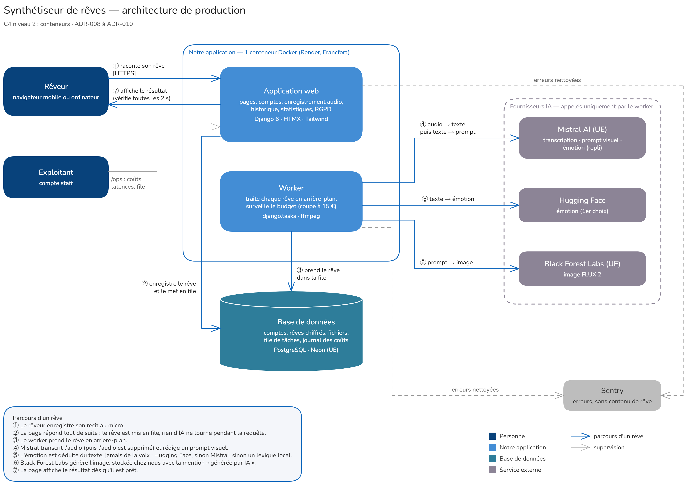

# Synthétiseur de rêves

Au réveil, vous racontez votre rêve à voix haute. L'application le transcrit, en déduit l'émotion dominante **à partir du texte**, crée une image onirique et range le tout dans un tableau de bord personnel : historique filtrable, statistiques, export et suppression de vos données.

Projet individuel, bloc production. Les livrables de pré-production (cadrage, architecture cible, benchmark, maquette) sont dans [`docs/preprod/`](docs/preprod/README.md).

| | |
|---|---|
| Code | https://github.com/BrownGreg/dream |
| Suivi | Jira, projet **DREAM**, epic DREAM-41 (les références DREAM-1 à 24 des branches correspondent aux clés Jira DREAM-42 à 65 : [`docs/backlog/`](docs/backlog/README.md)) |
| Production | Render (Francfort) — URL donnée dans le rapport une fois le service créé |
| Décisions | [`docs/decisions/`](docs/decisions/) (ADR-001 à ADR-010) |

## Identité visuelle

Logo, favicon et landing page conçus avec Claude Design : [`docs/identite/`](docs/identite/LISEZMOI.md) (SVG et PNG). La landing page (`templates/landing.html`) accueille les visiteurs non connectés sur `/` ; elle n'appelle aucune ressource externe (ni CDN, ni police distante).

## Architecture



Schéma dessiné sur Excalidraw (scène intégrée au PNG, rouvrable dans excalidraw.com pour le modifier). Version détaillée, générée depuis une source versionnée et reprise dans le rapport : [`c4_container.svg`](docs/diagrams/c4_container.svg) ([source PlantUML](docs/diagrams/c4_container.puml)).

Un monolithe **Django 6.0** (gabarits + HTMX + Tailwind) et un **worker** `django.tasks` (backend base de données) partagent une base **PostgreSQL** qui porte aussi la file de tâches et les fichiers. Le pipeline (transcription → émotion → prompt → image) ne s'exécute jamais dans une requête HTTP ; le navigateur suit l'avancement par polling HTMX toutes les 2 s. Détails : [ADR-008](docs/decisions/ADR-008-evolution-architecture-production.md) (architecture), [ADR-009](docs/decisions/ADR-009-budget-production.md) (budget), [ADR-010](docs/decisions/ADR-010-stockage-fichiers-en-base.md) (stockage), [séquence](docs/diagrams/sequence_reve.svg), [modèle de données](docs/diagrams/erd.svg) généré depuis le code.

| Étape | Fournisseur (ADR) | Repli |
|---|---|---|
| Transcription | Mistral Voxtral Mini Transcribe, UE (ADR-002) | message clair, audio conservé pour réessayer |
| Émotion (texte seulement) | Hugging Face, zero-shot mDeBERTa (ADR-008) | Mistral Small (JSON) → lexique français local |
| Prompt visuel | Mistral Small, sortie JSON (ADR-003) | — |
| Image | Black Forest Labs FLUX.2 [klein] 4B, UE (ADR-004) | une reformulation adoucie, puis placeholder ; état `partial` |
| Ambiance sonore (bonus) | boucles synthétisées par émotion, non génératives | — |

Chaque appel passe par un client résilient : délai, retries exponentiels sur 408/429/5xx seulement, journal `ApiCall` avec coût, **coupe-circuit à 15 €** (budget de production 20 €), quota de 5 rêves par jour et par utilisateur.

## Installation en une commande

Prérequis : Python 3.12 et [uv](https://docs.astral.sh/uv/), **ou** Docker.

```bash
git clone https://github.com/BrownGreg/dream.git && cd dream
make setup                     # .env (clés générées), dépendances, CSS, migrations, superuser
# ou
./scripts/install.sh --docker  # Docker Compose : web + worker + PostgreSQL
```

Sans clé d'API, tout fonctionne en `AI_MODE=fake` (adapters simulés, aucun coût). Données de démonstration : `DJANGO_DEBUG=true uv run python manage.py seed_demo` (compte `demo@example.org` / `demo-Reves-2026`).

## Lancement

| Commande | Effet |
|---|---|
| `make run` puis `make worker` (2ᵉ terminal) | serveur de développement et worker, sans Docker |
| `make dev` | pile Docker Compose complète sur http://localhost:8000 |
| `make test` | tests, couverture globale et **par fonctionnalité critique** (seuil 70 %) |
| `make e2e` | parcours navigateur (micro simulé) et audit d'accessibilité axe-core |
| `make lint` | ruff (PEP 8, docstrings Google) et mypy strict |
| `make load` | test de charge Locust (voir [`docs/tests/charge/`](docs/tests/charge/)) |

## Variables d'environnement

Toutes dans [`.env.example`](.env.example). Les principales :

| Variable | Rôle |
|---|---|
| `DJANGO_SECRET_KEY`, `FIELD_ENCRYPTION_KEYS` | secret Django ; clés Fernet du chiffrement des récits (générées par `make setup`) |
| `DATABASE_URL` | PostgreSQL (SQLite si vide, en développement) |
| `AI_MODE` | `fake` (défaut) ou `real` |
| `MISTRAL_API_KEY`, `HF_TOKEN`, `BFL_API_KEY` | clés des fournisseurs (mode `real`) |
| `AI_BUDGET_EUR`, `AI_USER_DAILY_DREAMS`, `AI_MAX_IMAGE_ATTEMPTS` | coupe-circuit, quota, régénérations |
| `SENTRY_DSN`, `LOG_JSON` | erreurs (nettoyées) et journaux JSON |

Les secrets ne sont jamais commités : `.env` en local, variables de la plateforme en production.

## Tests et qualité

[Stratégie de tests](docs/tests/strategie.md) · [accessibilité](docs/tests/accessibilite/README.md) · [charge](docs/tests/charge/) · [journal des incidents](docs/incidents.md).

La CI ([`ci.yml`](.github/workflows/ci.yml)) bloque toute fusion sur `main` tant que ces étapes ne sont pas vertes : lint → types → migrations → tests sur PostgreSQL → **70 % par fonctionnalité critique** → E2E Chromium (parcours micro + axe) → image Docker et test de fumée. Sur `main`, elle déclenche ensuite le déploiement Render du commit testé et vérifie `/health`.

## Déploiement

[`render.yaml`](render.yaml) décrit le service (Docker, Francfort ; web et worker dans le même conteneur, faute de worker gratuit chez Render). Base : Neon (UE, PostgreSQL, Francfort), reliée par la CLI `neon` : [`neon.ts`](neon.ts) et `package.json` décrivent la configuration du projet Neon (aucun service Neon autre que PostgreSQL n'est utilisé ; l'application ne lit que `DATABASE_URL`). Le déploiement n'est déclenché que par la CI, via le secret `RENDER_DEPLOY_HOOK_URL` ; `PROD_URL` permet le contrôle de `/health` après déploiement.

## Données personnelles

Le récit d'un rêve peut révéler la santé ou la vie intime (RGPD art. 9) : consentements séparés à l'inscription ; récit, titre et prompt **chiffrés en base** ; audio supprimé dès la transcription ; aucun contenu dans les journaux ni dans Sentry (testé) ; seul un prompt reformulé, sans nom, part vers le générateur d'image ; fichiers servis à leur seul propriétaire ; export ZIP/JSON et suppression immédiate du compte.

## Organisation du dépôt

```
config/      réglages base/dev/test/prod, observabilité, /health
accounts/    inscription, consentements, export et suppression RGPD
dreams/      modèles, pipeline, tâches, services (ports, adapters, client résilient, budget), stockage
dashboard/   historique, filtres, statistiques, /ops
tests/       unit/ integration/ e2e/ load/ fixtures/ cassettes/
docs/        decisions/ diagrams/ tests/ specs/ backlog/ incidents.md preprod/
scripts/     install, démarrage, couverture critique, ERD, charge
```
