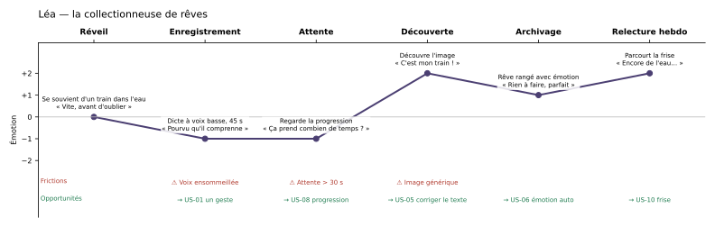
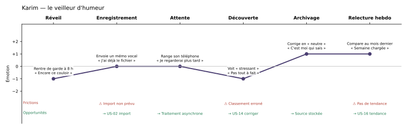
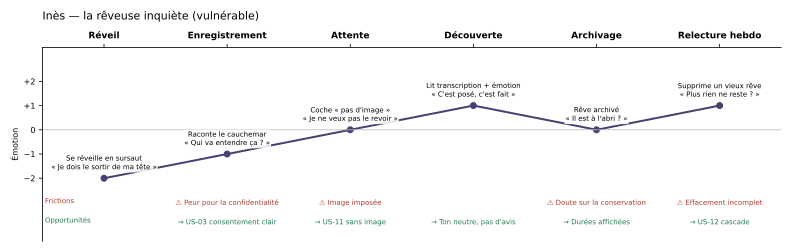
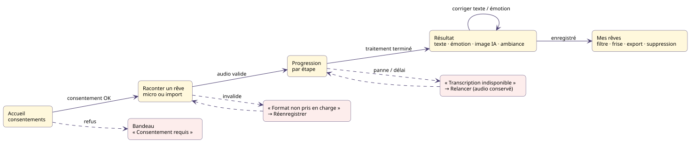
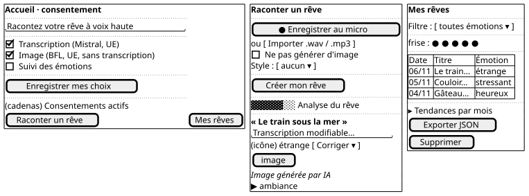

# 2. Personae & parcours

Personae construits à partir des entretiens simulés (annexe `interviews.md`). Inès représente l'**utilisateur vulnérable** : ses besoins fixent des exigences non négociables (US-03, US-11, US-12).

| | **Léa** — la collectionneuse de rêves | **Karim** — le veilleur d'humeur | **Inès** — la rêveuse inquiète (vulnérable) |
|---|---|---|---|
| Profil | 27 ans, designer UX, Lyon | 41 ans, infirmier de nuit, Lille | 34 ans, comptable, cauchemars récurrents depuis un accident |
| Niveau tech | Élevé | Moyen (dictaphone, montre) | Moyen, méfiante envers les applis « santé » |
| Contexte d'usage | Au lit, 7 h, téléphone, voix ensommeillée, partenaire endormi | 8 h en rentrant de garde, ou dans le bus ; fichiers déjà enregistrés | Au réveil après un cauchemar, émotion forte, parfois en pleine nuit |
| Objectifs | Capturer vite, relire, retrouver des motifs | Suivre la proportion de rêves stressants dans le temps | Déposer le rêve pour s'en détacher, sans le revoir en image |
| Frustrations | Écrire au réveil ; images génériques | Apps qui exigent un usage en direct ; classement non corrigeable | Contenu choquant imposé ; peur que ses rêves soient lus ou réutilisés |
| Ce qu'il faut pour elle / lui | Un geste, < 30 s d'attente, image fidèle | Import de fichier, émotion corrigeable, tendance mensuelle | Bouton « ne pas générer d'image », effacement total, aucune prétention médicale |
| Citation | « À 9 h je ne savais plus où allait le train. » | « Mes rêves, c'est mon thermomètre. » | « Je veux le sortir de ma tête, pas le revoir. » |

**Insights des entretiens éclair** (simulés, annexe `interviews.md`) et conséquences produit :

*Léa*

{{include ../annexes/interviews.md::table2}}

*Karim*

{{include ../annexes/interviews.md::table4}}

**Anti-persona** — *le chercheur de diagnostic* : attend de l'application une explication de ses rêves ou un avis sur sa santé mentale. Le produit ne le sert pas (US-22 *Won't*) et le lui dit : mention « indicateur personnel, sans valeur médicale » et renvoi vers un professionnel dans la page d'aide.

## Journey maps

Les trois parcours suivent les mêmes étapes (réveil → enregistrement → attente → découverte → archivage → relecture hebdomadaire). La courbe montre l'émotion ressentie (−2 à +2) ; les bandeaux listent les frictions et les opportunités retenues dans le backlog.

## Flow, wireframes et charte minimaliste

| Élément | Règle de la charte |
|---|---|
| Couleur principale | Violet nuit `#4B3F72` (titres, actions principales) ; fonds clairs, aucun aplat saturé au réveil |
| Couleurs d'émotion | Une couleur et une icône par émotion, contraste AA sur fond blanc ; source unique `src/dreamsynth/domain/emotion.py` |
| Typographie | Police sans empattement du système, 16 px minimum dans l'application |
| Interaction | Une seule action principale par écran ; zones tactiles ≥ 48 px (usage au lit, une main) |
| Ton | Messages courts, neutres, jamais culpabilisants ; aucune interprétation du rêve |
| Contenu IA | Mention « Image générée par IA » sous chaque image, sans exception |

Wireframes réalisés en PlantUML (syntaxe Salt) plutôt qu'en Figma : versionnés avec le code et régénérés par `tools/build_docs.py` ; la maquette Streamlit en est l'implémentation fonctionnelle.
