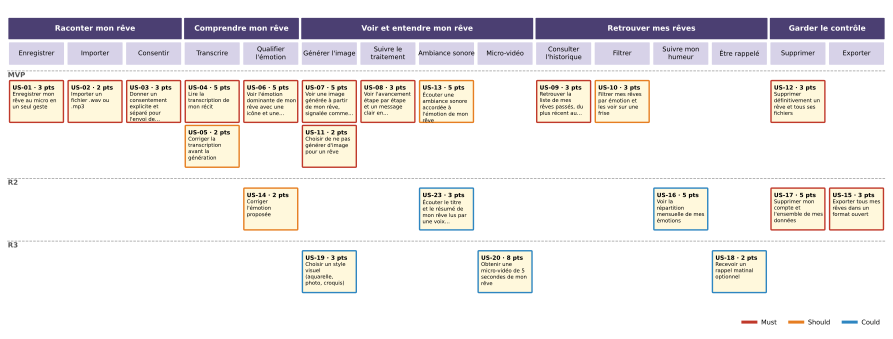

# 3. Carte des user stories et priorisation MoSCoW

Le backlog a une source unique, `docs/backlog/stories.toml`, d'où sont générés cette carte, les scénarios Gherkin exécutables (`tests/features/*.feature`), l'import Jira et la matrice de traçabilité. Le script de génération refuse un backlog incohérent : points hors Fibonacci, story basique (Kano) classée *Could*, story inverse non exclue.

Matrice de Kano (source : annexe `kano.md` ; B basique · P performance · E enthousiasmante · I indifférente · R inverse) :

{{include ../annexes/kano.md::table1}}



**Règles de priorisation**
- *Must* = sans elle, la release n'a pas de valeur ou n'est pas licite (consentement, effacement). Les 10 fonctionnalités basiques de la matrice de Kano (annexe `kano.md`) sont toutes en *Must*.
- *Should* = forte valeur, contournable une release (correction de transcription, filtre, ambiance).
- *Could* = enthousiasmant mais coûteux ou non validé (tendance mensuelle, style, micro-vidéo qui multiplie par 11,5 le coût d'un rêve, section 4).
- *Won't* = décidé et tracé : partage public et interprétation psychologique (Kano inverse).

**Découpage** : le MVP couvre le parcours complet d'un rêve (raconter → comprendre → voir → retrouver → supprimer) ; R2 ajoute la correction, la lecture vocale et les droits RGPD à l'échelle du compte avant l'ouverture de la bêta ; R3 ajoute les fonctions de confort. Export et suppression du compte (*Must*) arrivent en R2 parce que le MVP n'a pas d'utilisateur externe : ils sont livrés **avant** l'ouverture de la bêta, et la suppression d'un rêve (US-12) est déjà dans le MVP.

Chaque story porte des critères d'acceptation Gherkin (exemple ci-dessous) ; la liste complète est en annexe (`tests/features/`).

```gherkin
@US-11 @MVP
Scénario: Rêve sans image
  Étant donné que j'ai accepté le consentement
  Et que j'ai coché « Ne pas générer d'image »
  Quand je soumets un récit valide
  Alors aucun appel au générateur d'image n'est effectué
  Et mon rêve est enregistré avec sa transcription et son émotion
```

{{include _gen/story_map.md}}
