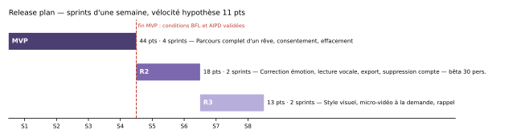

# 6. Roadmap et Sprint #1

## Release plan

| Release | Sprints | Contenu (stories) | Critère de sortie |
|---|---|---|---|
| **MVP** | S1–S4 | US-01 à US-13 (44 pts) : raconter, transcrire, analyser, illustrer, ambiance, retrouver, supprimer | Parcours complet sur l'architecture cible ; conditions BFL et actions AIPD validées ; SLO mesurés |
| **R2** | S5–S6 | US-14 à US-17, US-23 (18 pts) : correction d'émotion, export, tendance, suppression du compte, lecture vocale | Bêta privée de 30 personnes ouverte ; mesure de CS-01, CS-05, CS-06 |
| **R3** | S7–S8 | US-18 à US-20 (13 pts) : rappel, style, micro-vidéo à la demande | Prix vidéo réévalués ; décision go / no-go sur la vidéo |

La durée en sprints est calculée à une **vélocité hypothétique de 11 points** (engagement du Sprint 1) ; elle est recalculée à la fin de chaque sprint avec la vélocité mesurée. Outillage : Jira (import `docs/annexes/jira_import.csv` : 5 épopées = activités de la story map, 21 stories avec points, priorité et critères Gherkin, 13 tâches du Sprint 1).

## Backlog détaillé du Sprint #1 (1 semaine)

{{include _gen/sprint1.md}}

**Definition of Ready** (rappel, section 8) : story estimée, critères Gherkin écrits, exigences liées, maquette ou contrat d'API disponible, dépendance fournisseur levée.
