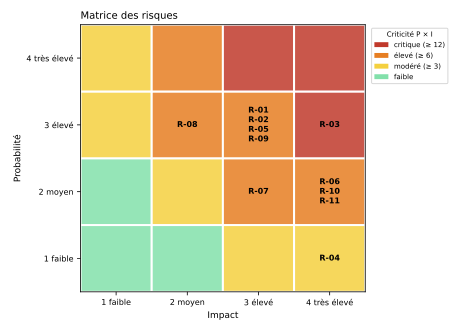

# 7. Plan de risques

Registre de 11 risques (source `docs/backlog/risks.toml`), revu à chaque rétrospective : la probabilité et l'impact sont réévalués, un risque dont le déclencheur survient devient un ticket prioritaire.

{{include _gen/risks.md}}

**Lecture** : un seul risque est critique (R-03, conditions contractuelles BFL) ; il bloque la sortie du MVP et dispose d'un repli prêt. Les trois risques « impact très élevé » à probabilité moyenne (R-06, R-10, R-11) portent sur la dépendance fournisseur, la sécurité et l'éthique : leurs préventions sont inscrites dans l'architecture (replis par adapter, chiffrement, absence d'interprétation).
