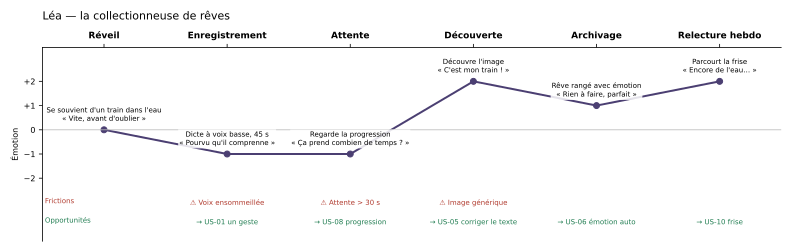
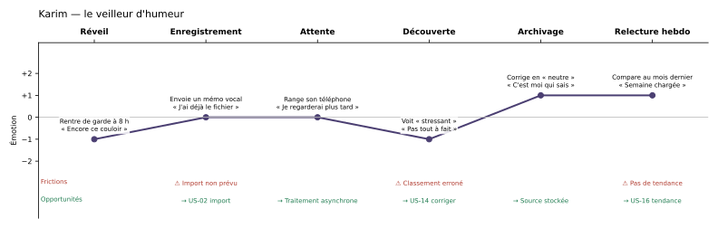
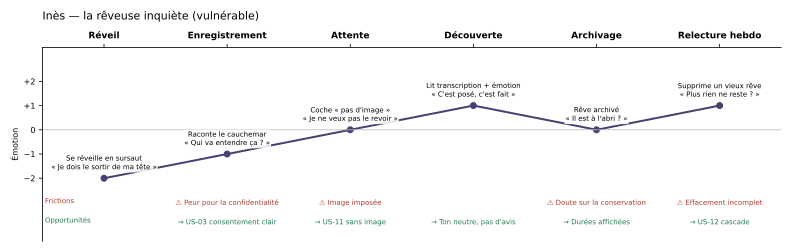
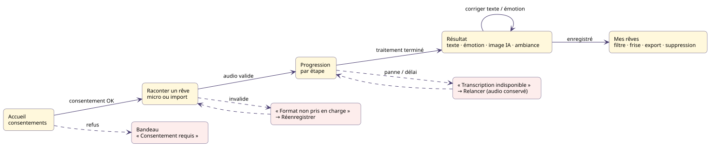
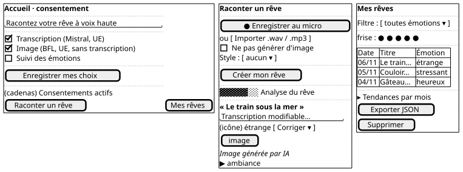
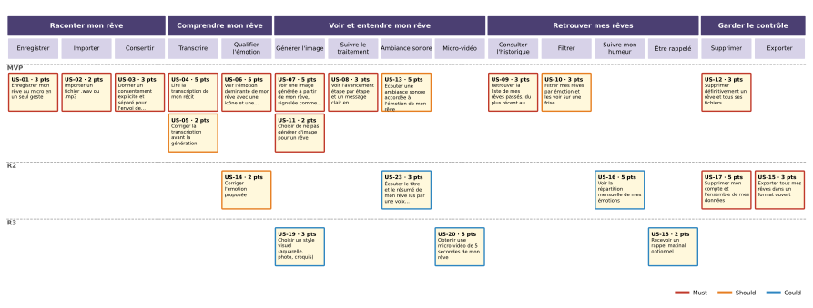
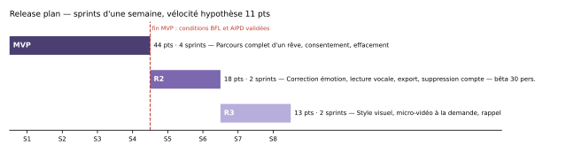
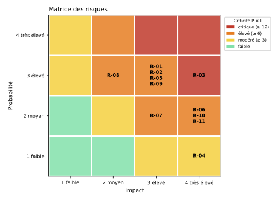

# 1. Vision produit

## Elevator pitch

> **Pour** les personnes qui se souviennent de leurs rêves au réveil et veulent les garder,
> **qui** n'ont ni le temps ni l'énergie d'écrire un journal de rêves à 7 h du matin,
> **le Synthétiseur de rêves est** une application web de journal onirique vocal
> **qui** transforme un récit dicté en 60 secondes en une image, une ambiance sonore et une humeur, rangés dans un historique personnel ;
> **contrairement aux** journaux de rêves textuels (carnet papier, applications de notes) qui demandent d'écrire et ne restituent rien,
> **notre produit** ne demande qu'un récit dicté, le restitue en image et en ambiance, et efface tout en un clic : ni interprétation psychologique, ni partage.

## Périmètre

| Dans le produit | Hors produit (décidé) |
|------------------------------------------------------------|------------------------------------------------------------|
| Récit vocal ou fichier audio → transcription → image + ambiance → émotion → historique | Interprétation « psychologique » des rêves (US-22, *Won't* — prétention diagnostique) |
| Émotion inférée du **texte** transcrit | Analyse de la voix (prosodie) — cf. ADR-001 et section 5 |
| Suivi personnel de l'humeur dans le temps | Partage public (US-21, *Won't* — Kano inverse) |

## Critères de succès (SMART)

Ces critères sont **la** définition du succès ; les SLO techniques (ADR-006) et le budget (ADR-007) en découlent.

| ID | Critère | Cible | Mesure | Échéance |
|-----------|------------------------|--------------------------------|-------------------------------------|----------------|
| CS-01 | Réutilisation | ≥ 40 % des bêta-testeurs ayant raconté un rêve en racontent un 2ᵉ sous 7 jours | Événements `dream.created` par utilisateur, bêta privée de 30 personnes | Fin R2 |
| CS-02 | Latence perçue | p95 « fin d'envoi → image affichée » ≤ 30 s | Traces par étape (`api_calls`), 100 rêves consécutifs en préproduction | Fin MVP |
| CS-03 | Coût unitaire | ≤ 0,05 $ d'appels API par rêve, tous fournisseurs confondus | Somme `api_calls.cost_usd` / nombre de rêves, sur 30 jours | Fin MVP |
| CS-04 | Conformité | 0 donnée de rêve envoyée à un fournisseur sans DPA signé ni opt-out d'entraînement actif | Registre des sous-traitants vérifié à chaque release (checklist DoD) | Chaque release |
| CS-05 | Fiabilité | ≥ 98 % des rêves soumis aboutissent (avec ou sans image) | `dreams.status = done` / rêves soumis, 30 jours glissants | Fin R2 |
| CS-06 | Fidélité perçue | Note moyenne ≥ 4/5 à « l'image ressemble à mon rêve » | Notation facultative après affichage, ≥ 50 rêves notés | Fin R2 |

Les cibles sont des **hypothèses de pilotage** posées en pré-production ; CS-02 et CS-03 sont confrontées au benchmark (section 4), les autres seront mesurées en bêta.

# 2. Personae & parcours

Personae construits à partir des entretiens simulés (annexe `interviews.md`). Inès représente l'**utilisateur vulnérable** : ses besoins fixent des exigences non négociables (US-03, US-11, US-12).

| | **Léa** — la collectionneuse de rêves | **Karim** — le veilleur d'humeur | **Inès** — la rêveuse inquiète (vulnérable) |
|-----------------------|--------------------------------|--------------------------------|--------------------------------|
| Profil | 27 ans, designer UX, Lyon | 41 ans, infirmier de nuit, Lille | 34 ans, comptable, cauchemars récurrents depuis un accident |
| Niveau tech | Élevé | Moyen (dictaphone, montre) | Moyen, méfiante envers les applis « santé » |
| Contexte d'usage | Au lit, 7 h, téléphone, voix ensommeillée, partenaire endormi | 8 h en rentrant de garde, ou dans le bus ; fichiers déjà enregistrés | Au réveil après un cauchemar, émotion forte, parfois en pleine nuit |
| Objectifs | Capturer vite, relire, retrouver des motifs | Suivre la proportion de rêves stressants dans le temps | Déposer le rêve pour s'en détacher, sans le revoir en image |
| Frustrations | Écrire au réveil ; images génériques | Apps qui exigent un usage en direct ; classement non corrigeable | Contenu choquant imposé ; peur que ses rêves soient lus ou réutilisés |
| Ce qu'il faut pour elle / lui | Un geste, < 30 s d'attente, image fidèle | Import de fichier, émotion corrigeable, tendance mensuelle | Bouton « ne pas générer d'image », effacement total, aucune prétention médicale |
| Citation | « À 9 h je ne savais plus où allait le train. » | « Mes rêves, c'est mon thermomètre. » | « Je veux le sortir de ma tête, pas le revoir. » |

**Insights des entretiens éclair** (simulés, annexe `interviews.md`) et conséquences produit :

*Léa*

| Insight | Conséquence |
|------------------------------------------------------------|------------------------------------------------------------|
| La fenêtre de mémoire est de quelques minutes après le réveil | Enregistrement en **un geste**, consentement donné une seule fois (US-01, US-03) |
| Voix basse et pâteuse, environnement silencieux à préserver | Le STT doit tenir sur voix chuchotée : critère « qualité FR » du benchmark, corpus avec 1 récit chuchoté ; transcription **corrigeable** (US-05) |
| La valeur est dans la relecture, pas dans la capture | Historique et frise dès le MVP (US-09, US-10) |
| Une image générique déçoit plus qu'aucune image | Réécriture du récit en prompt visuel par LLM avant génération (ADR-003) ; style choisi en R3 (US-19) |
| L'interprétation est perçue comme non crédible | US-22 en *Won't* ; aucune promesse de sens |

*Karim*

| Insight | Conséquence |
|------------------------------------------------------------|------------------------------------------------------------|
| Usage asynchrone : le fichier existe déjà sur le téléphone | Import .wav/.mp3 au même niveau que le micro (US-02) |
| Le rêve est vécu comme un indicateur d'humeur | Émotion + icône au MVP (US-06), tendance mensuelle en R2 (US-16) avec mention « sans valeur médicale » |
| Le classement automatique doit rester corrigeable | Correction de l'émotion (US-14) ; la source de l'émotion (modèle / utilisateur) est stockée |
| La localisation des données conditionne la confiance | Critère « localisation UE » pondéré dans le scoring ; préférence fournisseurs UE (ADR-002 à ADR-004) |
| Faible disposition à payer au départ | Coût par rêve contraint (CS-03 ≤ 0,05 $) |

**Anti-persona** — *le chercheur de diagnostic* : attend de l'application une explication de ses rêves ou un avis sur sa santé mentale. Le produit ne le sert pas (US-22 *Won't*) et le lui dit : mention « indicateur personnel, sans valeur médicale » et renvoi vers un professionnel dans la page d'aide.

## Journey maps

Les trois parcours suivent les mêmes étapes (réveil → enregistrement → attente → découverte → archivage → relecture hebdomadaire). La courbe montre l'émotion ressentie (−2 à +2) ; les bandeaux listent les frictions et les opportunités retenues dans le backlog.







## Flow, wireframes et charte minimaliste




| Élément | Règle de la charte |
|-------------------------------|-----------------------------------------------------------------------------------------|
| Couleur principale | Violet nuit `#4B3F72` (titres, actions principales) ; fonds clairs, aucun aplat saturé au réveil |
| Couleurs d'émotion | Une couleur et une icône par émotion, contraste AA sur fond blanc ; source unique `src/dreamsynth/domain/emotion.py` |
| Typographie | Police sans empattement du système, 16 px minimum dans l'application |
| Interaction | Une seule action principale par écran ; zones tactiles ≥ 48 px (usage au lit, une main) |
| Ton | Messages courts, neutres, jamais culpabilisants ; aucune interprétation du rêve |
| Contenu IA | Mention « Image générée par IA » sous chaque image, sans exception |

Wireframes réalisés en PlantUML (syntaxe Salt) plutôt qu'en Figma : versionnés avec le code et régénérés par `tools/build_docs.py` ; la maquette Streamlit en est l'implémentation fonctionnelle.

# 3. Carte des user stories et priorisation MoSCoW

Le backlog a une source unique, `docs/backlog/stories.toml`, d'où sont générés cette carte, les scénarios Gherkin exécutables (`tests/features/*.feature`), l'import Jira et la matrice de traçabilité. Le script de génération refuse un backlog incohérent : points hors Fibonacci, story basique (Kano) classée *Could*, story inverse non exclue.

Matrice de Kano (source : annexe `kano.md` ; B basique · P performance · E enthousiasmante · I indifférente · R inverse) :

| Fonctionnalité | Kano | Justification (1 ligne) | Stories | MoSCoW |
|---------------------------------|-----------|-----------------------------------------|------------------|----------------|
| Enregistrement micro en un geste | B | Sans capture immédiate, le rêve est perdu (Léa, Q1). | US-01 | Must |
| Import .wav / .mp3 | B | Karim enregistre déjà avec son dictaphone ; exigence du sujet. | US-02 | Must |
| Consentement explicite et granulaire | B | Inès n'utilise pas un service qui ne dit pas où part sa voix. | US-03 | Must |
| Transcription affichée | B | Preuve que le rêve a été « entendu » ; base de tout le reste. | US-04 | Must |
| Correction de la transcription | P | Plus la correction est simple, plus l'image est fidèle. | US-05 | Should |
| Émotion + icône + couleur | P | Valeur croissante avec la justesse du classement (Karim, Q6). | US-06 | Must |
| Correction de l'émotion | P | Restitue le contrôle quand le modèle se trompe (Karim, Q7). | US-14 | Should |
| Image générée (fidélité) | P | Satisfaction proportionnelle à la ressemblance (Léa, Q7). | US-07 | Must |
| Progression visible + erreurs claires | B | Une attente muette est vécue comme une panne (Léa, Q6). | US-08 | Must |
| Option « ne pas générer d'image » | B | Pour le segment vulnérable, l'image imposée est un motif d'abandon. | US-11 | Must |
| Historique des rêves | B | La relecture est la raison d'être du journal (Léa, Q4). | US-09 | Must |
| Filtre par émotion + frise | P | Rend l'historique exploitable à mesure qu'il grossit. | US-10 | Should |
| Suppression d'un rêve en cascade | B | Droit à l'effacement attendu par tous, critique pour Inès. | US-12 | Must |
| Suppression du compte | B | Idem, à l'échelle du compte. | US-17 | Must |
| Export de mes données | B | Portabilité attendue dès qu'il y a des données personnelles. | US-15 | Must |
| Ambiance sonore | E | Non demandée spontanément ; effet « waouh » attendu. | US-13 | Should |
| Lecture vocale du résumé | E | Prolonge l'immersion ; jamais demandée. | US-23 | Could |
| Tendance mensuelle des émotions | E | Personne ne l'exige, Karim y voit son « thermomètre ». | US-16 | Could |
| Choix du style visuel | E | Personnalisation appréciée, jamais réclamée. | US-19 | Could |
| Micro-vidéo | E | Promesse forte mais coût et latence élevés (cf. section 4). | US-20 | Could |
| Rappel matinal | I | Ni attendu ni rejeté ; risque d'intrusion au réveil. | US-18 | Could |
| Partage public sur les réseaux | R | Rêves jugés « plus intimes que mes photos » (Léa, Q8). | US-21 | Won't |
| Interprétation psychologique | R | Perçue comme non crédible (Léa, Q9) et risquée (prétention diagnostique). | US-22 | Won't |



**Règles de priorisation**

- *Must* = sans elle, la release n'a pas de valeur ou n'est pas licite (consentement, effacement). Les 10 fonctionnalités basiques de la matrice de Kano (annexe `kano.md`) sont toutes en *Must*.
- *Should* = forte valeur, contournable une release (correction de transcription, filtre, ambiance).
- *Could* = enthousiasmant mais coûteux ou non validé (tendance mensuelle, style, micro-vidéo qui multiplie par 11,5 le coût d'un rêve, section 4).
- *Won't* = décidé et tracé : partage public et interprétation psychologique (Kano inverse).

**Découpage** : le MVP couvre le parcours complet d'un rêve (raconter → comprendre → voir → retrouver → supprimer) ; R2 ajoute la correction, la lecture vocale et les droits RGPD à l'échelle du compte avant l'ouverture de la bêta ; R3 ajoute les fonctions de confort. Export et suppression du compte (*Must*) arrivent en R2 parce que le MVP n'a pas d'utilisateur externe : ils sont livrés **avant** l'ouverture de la bêta, et la suppression d'un rêve (US-12) est déjà dans le MVP.

Chaque story porte des critères d'acceptation Gherkin (exemple ci-dessous) ; la liste complète est en annexe (`tests/features/`).

```gherkin
@US-11 @MVP
Scénario: Rêve sans image
  Étant donné que j'ai accepté le consentement
  Et que j'ai coché « Ne pas générer d'image »
  Quand je soumets un récit valide
  Alors aucun appel au générateur d'image n'est effectué
  Et mon rêve est enregistré avec sa transcription et son émotion
```


**MVP** : 13 stories, 44 pts · **R2** : 5 stories, 18 pts · **R3** : 3 stories, 13 pts

| Rel. | ID | Tâche | « Je veux… » | Kano | MoSCoW | Pts |
|---------|----------|----------------------|--------------------------------|---------------------------|------------|-------|
| MVP | US-01 | Enregistrer | Enregistrer mon rêve au micro en un seul geste | basique | Must | 3 |
| MVP | US-02 | Importer | Importer un fichier .wav ou .mp3 | basique | Must | 2 |
| MVP | US-03 | Consentir | Donner un consentement explicite et séparé pour l'envoi de ma voix et de mon récit aux services d'IA | basique | Must | 3 |
| MVP | US-04 | Transcrire | Lire la transcription de mon récit | basique | Must | 5 |
| MVP | US-05 | Transcrire | Corriger la transcription avant la génération | performance | Should | 2 |
| MVP | US-06 | Qualifier l'émotion | Voir l'émotion dominante de mon rêve avec une icône et une couleur | performance | Must | 5 |
| MVP | US-07 | Générer l'image | Voir une image générée à partir de mon rêve, signalée comme produite par IA | performance | Must | 5 |
| MVP | US-08 | Suivre le traitement | Voir l'avancement étape par étape et un message clair en cas d'échec | basique | Must | 3 |
| MVP | US-09 | Consulter l'historique | Retrouver la liste de mes rêves passés, du plus récent au plus ancien | basique | Must | 3 |
| MVP | US-10 | Filtrer | Filtrer mes rêves par émotion et les voir sur une frise | performance | Should | 3 |
| MVP | US-11 | Générer l'image | Choisir de ne pas générer d'image pour un rêve | basique | Must | 2 |
| MVP | US-12 | Supprimer | Supprimer définitivement un rêve et tous ses fichiers | basique | Must | 3 |
| MVP | US-13 | Ambiance sonore | Écouter une ambiance sonore accordée à l'émotion de mon rêve | enthousiasmante | Should | 5 |
| R2 | US-14 | Qualifier l'émotion | Corriger l'émotion proposée | performance | Should | 2 |
| R2 | US-15 | Exporter | Exporter tous mes rêves dans un format ouvert | basique | Must | 3 |
| R2 | US-16 | Suivre mon humeur | Voir la répartition mensuelle de mes émotions | enthousiasmante | Could | 5 |
| R2 | US-17 | Supprimer | Supprimer mon compte et l'ensemble de mes données | basique | Must | 5 |
| R2 | US-23 | Ambiance sonore | Écouter le titre et le résumé de mon rêve lus par une voix française | enthousiasmante | Could | 3 |
| R3 | US-18 | Être rappelé | Recevoir un rappel matinal optionnel | indiff. | Could | 2 |
| R3 | US-19 | Générer l'image | Choisir un style visuel (aquarelle, photo, croquis) | enthousiasmante | Could | 3 |
| R3 | US-20 | Micro-vidéo | Obtenir une micro-vidéo de 5 secondes de mon rêve | enthousiasmante | Could | 8 |
| — | US-21 | Partager | Publier mon rêve sur un réseau social | inverse | Won't | — |
| — | US-22 | Qualifier l'émotion | Obtenir une interprétation psychologique de mon rêve | inverse | Won't | — |

# 4. Étude d'art et benchmark technologique

## Méthode

- **Shortlist** : 7 options STT (6 API, 1 auto-hébergée), 3 options LLM/émotion (dont 1 auto-hébergée), 6 générateurs d'image, 2 générateurs vidéo, 4 TTS, 3 sources d'ambiance — au moins une option hébergée dans l'UE par catégorie.
- **Sources** : uniquement les pages officielles des fournisseurs (prix, DPA, conditions, politique de données), consultées le 2026-11-02 ; chaque URL figure dans l'onglet `Sources` de l'annexe `benchmark.xlsx`. Deux valeurs ne sont pas publiées en clair (FLUX.2) : elles sont marquées ESTIMÉ avec leur méthode.
- **Coût sur 10 rêves/jour** : hypothèses explicites et modifiables (onglet `Hypothèses`) — récit d'1 min (H1), 700/250 tokens LLM (H2/H3), une image 1 MP (H4), 400 caractères lus (H6), 5 % de régénération (H8). Toutes les cellules de coût sont des formules.
- **Latence** : `benchmark/run_latency.py` envoie 10 à 30 appels par fournisseur sur un corpus fixe (5 récits FR synthétiques de 30 à 34 s, 5 prompts visuels), mesure le temps jusqu'au premier octet et le temps total, compte les retries à part (`tenacity`) et exporte des CSV horodatés. Le mode `--mock` valide la chaîne sans clé ; seules les mesures `--live` alimentent le classeur.
- **Qualité FR** : WER (`jiwer`) des transcriptions contre les textes de référence du corpus (`benchmark/wer.py`).

## Tableau comparatif


Prix et clauses consultés le 2026-11-02. Coût par rêve selon les hypothèses H1–H8 (annexe `benchmark.xlsx`, onglet Hypothèses).

| Cat. | Fournisseur — modèle | $/rêve | p95 (s) | Quota | UE · DPA | Entraînement |
|-------|-----------------------------------------------|--------|---------------|--------------|------------|---------------|
| STT | Mistral AI — voxtral-mini-transcribe-3 | 0,0035 | n. m. | Non publié (d… | oui · Oui | Opt-out via Admin panel › Privacy… |
| STT | Mistral AI — voxtral-small-transcribe-3 | 0,0040 | n. m. | Non publié (d… | oui · Oui | Opt-out via Admin panel › Privacy |
| STT | OpenAI — gpt-transcribe | 0,0045 | n. m. | Non trouvé (g… | non · non trouvé | Non par défaut |
| STT | Deepgram — nova-3 (monolingue, pré-enregistré) | 0,0043 | n. m. | 50 requêtes s… | non · Mentionné (… | non trouvé |
| STT | AssemblyAI — Universal-3.5 Pro | 0,0035 | n. m. | Non trouvé en… | non · Oui | Oui par défaut, opt-out possible |
| STT | ElevenLabs — Scribe v2 | 0,0037 | n. m. | Concurrence f… | non · Oui | non trouvé |
| STT | SYSTRAN faster-whisper (auto-hébergé) — small (int8, CPU 8 cœurs) | NP | 3,81 | Limité par le… | oui · Sans objet | Non (aucun tiers) |
| LLM | Mistral AI — Mistral Small 4 (mistral-small-2603) | 0,0003 | n. m. | Non publié (d… | oui · Oui | Opt-out via Admin panel › Privacy |
| LLM | OpenAI — gpt-4o-mini | 0,0003 | n. m. | 5 000 RPM · 2… | non · non trouvé | Non par défaut |
| LLM | Hugging Face (auto-hébergé) — MoritzLaurer/mDeBERTa-v3-base-mnli-xnli | NP | auto-hébergé | Limité par le… | oui · Sans objet | Non (aucun tiers) |
| Image | Black Forest Labs — FLUX.2 [pro] | 0,0315 ᴱ | n. m. | 24 requêtes s… | oui · non trouvé | Oui par défaut ; opt-out par e-ma… |
| Image | Black Forest Labs — FLUX.2 [klein] | 0,0147 ᴱ | n. m. | 24 requêtes s… | oui · non trouvé | Oui par défaut ; opt-out par e-ma… |
| Image | Google (Gemini API, payant) — Nano Banana 2.1 | 0,0353 | n. m. | Palier 1 : 10… | non · Oui (Proces… | Non en offre payante (oui en grat… |
| Image | Stability AI — Stable Image Core | 0,0315 | n. m. | 150 requêtes … | non · non trouvé | Oui par défaut, opt-out possible |
| Image | Stability AI — Stable Image Ultra | 0,0840 | n. m. | 150 requêtes … | non · non trouvé | Oui par défaut, opt-out possible |
| Image | OpenAI — gpt-image-1-mini (medium) | 0,0115 | n. m. | Non trouvé (g… | non · non trouvé | Non par défaut |
| Vidéo | Runway — gen4_turbo | 0,2500 | n. m. | Pas de limite… | non · non trouvé | non trouvé |
| Vidéo | Google (Gemini API) — gemini-omni-1.1-flash (720p) | 0,5000 | n. m. | Palier 1 : 10… | non · Oui (Proces… | Non en offre payante |
| TTS | Mistral AI — voxtral-mini-tts-3-0 | 0,0052 | n. m. | Non publié (d… | oui · Oui | Opt-out via Admin panel › Privacy |
| TTS | Microsoft Azure AI Speech — Neural TTS (S1, West Europe) | 0,0060 | n. m. | 30 transactio… | oui · non trouvé | non trouvé |
| TTS | OpenAI — tts-1 | 0,0060 | n. m. | Non trouvé (g… | non · non trouvé | Non par défaut |
| TTS | ElevenLabs — Flash / Turbo | 0,0160 | n. m. | Concurrence f… | non · Oui | non trouvé |
| Son | ElevenLabs — Sound Effects | 0,0400 | n. m. | Concurrence f… | non · Oui | non trouvé |
| Son | Stability AI — Stable Audio 3.0 | 0,0800 | n. m. | 150 requêtes … | non · non trouvé | Oui par défaut, opt-out possible |
| Son | Bibliothèque interne (sons CC0 par émotion) — 6 boucles pré-composées | 0,0000 | local | Aucun | oui · Sans objet | Sans objet |

**Mesure réelle** (local) — `faster_whisper_selfhosted` : 10 appels, p50 3,39 s, p95 3,81 s, premier segment p50 2,25 s, WER 13,2 % (latency_local_20261106T104153Z.csv) ; fichier `summary_local_20261106T104153Z.csv`.

ᴱ prix ESTIMÉ (non publié en clair, méthode dans le classeur) · NP : non publié (auto-hébergé, coût d'infrastructure) · *n. m.* = NON MESURÉ — mock : aucune latence mesurée faute de clé, la colonne reste vide de chiffre.

| Scénario | $/rêve | $/jour | $/mois | $/an | $/mois bêta | ≤ 0,05 $ (CS-03) |
|------------------------------|---------------|---------------|---------------|---------------|---------------|-----------------|
| S1 MVP retenu ᴱ | 0,0185 | 0,185 | 5,54 | 67,36 | 8,30 | oui |
| S2 R2 (+ lecture vocale) ᴱ | 0,0237 | 0,237 | 7,10 | 86,34 | 10,64 | oui |
| S3 Montée en qualité FLUX.2 [pro] ᴱ | 0,0353 | 0,353 | 10,58 | 128,68 | 15,86 | oui |
| S4 Ambiance générée (ElevenLabs) ᴱ | 0,0637 | 0,637 | 19,10 | 232,34 | 28,64 | non |
| S5 Fournisseurs US | 0,0960 | 0,960 | 28,81 | 350,53 | 43,22 | non |
| S6 R3 micro-vidéo ᴱ | 0,2737 | 2,736 | 82,10 | 998,84 | 123,14 | non |

ᴱ contient au moins un prix ESTIMÉ (FLUX.2, non publié en clair). Mois = 30 jours (H9), an = 365 jours. Bêta : 30 utilisateurs × 0,5 rêve/jour (H10, H11 ESTIMÉ) = 15 rêves/jour.


## Lecture des résultats

1. **L'image fait le coût** : elle représente 80 % du coût d'un rêve du scénario MVP ; STT et LLM pèsent ensemble 20 %. Le choix du modèle d'image est donc le premier levier : FLUX.2 [klein] coûte 53 % de moins que [pro], qui n'a pour lui qu'une qualité non encore mesurée.
2. **Les options « sonores » génératives sont disproportionnées** : une ambiance générée multiplie le coût par rêve par 2,7 (S4 vs S2) ; une micro-vidéo de 5 s par 11,5 (S6 vs S2). D'où l'ambiance par bibliothèque au MVP et la vidéo à la demande en R3 (ADR-005).
3. **Le scoring ne porte encore que sur 3 critères sur 5** (coût, RGPD, intégration : 60 % des poids) : latence et WER ne sont mesurés que pour faster-whisper (local), classé 3ᵉ des STT sans critère de coût ; sa note de latence est maximale par construction, puisqu'il est le seul mesuré. Voxtral Mini reste 1ᵉʳ ; les rangs seront recalculés après la campagne `--live`.
4. **Le RGPD départage plus que le prix** : en STT, cinq offres sont à moins de 0,001 $ d'écart ; seule Voxtral combine hébergement UE par défaut, DPA publié et opt-out d'entraînement documenté.
5. **Fin de vie** : trois modèles OpenAI du périmètre (gpt-4o-transcribe, gpt-image-1-mini, gpt-4o-mini-tts) sont marqués *Deprecated* et gpt-image-1 a été arrêté le 23/10/2026 (pages modèles OpenAI consultées le 2026-11-02) — le choix doit donc rester réversible (ports/adapters, section 6 des spécifications).

## Choix retenus (détail dans les ADR)

| Étape | Choix | Repli | ADR |
|----------------------------|-------------------------------------|-------------------------------------|------------------|
| Transcription | Mistral Voxtral Mini Transcribe 3 | Voxtral Small (si WER > 10 %) · faster-whisper auto-hébergé | ADR-002 |
| Prompt visuel + émotion | Mistral Small 4, sortie JSON validée par schéma | mDeBERTa zero-shot (émotion seule) | ADR-001, ADR-003 |
| Image | FLUX.2 [klein], endpoint UE — sous 3 conditions (prix, opt-out, DPA) | [pro] si le test de fidélité (Sprint 3, section 8) est défavorable · Nano Banana 2.1 (payant) | ADR-004 |
| Ambiance | Bibliothèque CC0, 6 boucles par émotion | — | ADR-005 |
| Lecture vocale (R2) | Voxtral TTS, voix française | Azure Neural TTS (région UE) | ADR-005 |
| Budget | 25 $/mois en bêta (15 rêves/jour estimés), alerte 80 %, coupe-circuit image à 100 % | — | ADR-007 |

Un seul fournisseur principal (Mistral) pour STT, LLM et TTS : un DPA, un registre de sous-traitance simple, mais une dépendance concentrée — risque R-06, couvert par les replis ci-dessus.

## KPIs retenus

| ID | KPI | Cible | Mesuré en pré-production ? |
|--------|----------------------------------------------|--------------------|----------------------------------------------|
| K1 | Latence p95 bout-en-bout (fin d'envoi → image affichée) | ≤ 30 s (CS-02) | Non — clé requise ; somme des p95 par étape dès la campagne live |
| K2 | Coût API par rêve | ≤ 0,05 $ (CS-03) | Calculé : 0,0185 $ (S1, contient un prix ESTIMÉ) |
| K3 | WER sur le corpus FR | ≤ 10 % | Partiel : 13,2 % pour faster-whisper `small` local, sur voix de synthèse espeak ; Voxtral : clé requise |
| K4 | Taux d'échec API après retries | ≤ 2 % | Non — clé requise |
| K5 | Taux de rejet par le filtre de sécurité image | ≤ 5 % | Non — clé T2I requise |
| K6 | Part des traitements effectués dans l'UE | 100 % au MVP | Par construction du scénario S1 |
| K7 | Sorties LLM conformes au schéma | ≥ 99 % | Non — clé requise |
| K8 | Émotions non corrigées par l'utilisateur | ≥ 80 % | En bêta (R2) |

Les cibles sont des hypothèses de pilotage reliées aux critères de succès (K1 ↔ CS-02, K2 ↔ CS-03, K4 ↔ CS-05, K6 ↔ CS-04) ; les seuils K3, K5, K7 et K8 sont des choix de conception, révisés après la première campagne de mesure.

# 5. Analyse RGPD & éthique IA

Références consultées le 2026-11-06 : RGPD (texte publié par la CNIL, `cnil.fr/fr/reglement-europeen-protection-donnees`) ; AI Act, règlement (UE) 2024/1689 (version consolidée `artificialintelligenceact.eu` ; à vérifier sur le texte du Journal officiel avant soutenance) ; lignes directrices WP248 rév.01 sur l'AIPD ; *Guide RGPD du développeur* et fiche *Les durées de conservation des données* de la CNIL. URLs complètes en annexe `aipd.md`.

## 5.1 Nature des données et base légale

| Donnée | Qualification | Position |
|-----------------------------------|-------------------------------------------|-------------------------------------------|
| Récit transcrit, émotion, image | Peut révéler santé, vie sexuelle, convictions, traumatismes : **catégories particulières** (art. 9.1) | Traitée par défaut comme sensible, pour tous les rêves, sans tri automatique |
| Audio de la voix | Donnée personnelle ; devient **biométrique** seulement si traitée « aux fins d'identifier une personne physique de manière unique » (art. 9.1) | Jamais traitée pour identifier ni pour en extraire des émotions (ADR-001) ; supprimée après transcription |
| Compte, consentements, journaux | Données personnelles ordinaires | Minimisées (e-mail seul, identifiant pseudonyme vers les API) |

**Base légale : consentement explicite** (art. 9.2.a, « pour une ou plusieurs finalités spécifiques »). Il est **granulaire** (trois cases distinctes : transcription · génération d'image · suivi des émotions dans le temps), donné avant le premier envoi (US-03), **révocable** à tout moment depuis les réglages, et horodaté dans la table `consents` (version du texte affiché incluse). Refuser la génération d'image ou le suivi n'empêche pas d'utiliser le journal.

## 5.2 AIPD : requise

L'art. 35.1 impose une analyse d'impact lorsqu'un traitement, « en particulier par le recours à de nouvelles technologies », est susceptible d'engendrer un risque élevé. Selon WP248, un traitement qui remplit **deux critères** requiert en général une AIPD. Le nôtre en remplit quatre :

| Critère WP248 | Application au produit |
|------------------------------------------------------------|------------------------------------------------------------|
| 4 — données sensibles ou à caractère hautement personnel | Contenu des rêves (art. 9) |
| 1 — évaluation / notation | Classement émotionnel de chaque rêve et tendance mensuelle (US-06, US-16) |
| 8 — usage innovant de nouvelles technologies | Chaîne de modèles d'IA génératifs (STT, LLM, image) |
| 7 — personnes vulnérables | Utilisateurs sujets aux cauchemars ou traumatismes (persona Inès) |

AIPD synthétique (annexe `aipd.md`, à conduire avec l'outil PIA de la CNIL avant la bêta) — risques principaux et mesures :

| Risque pour la personne | Gravité | Mesures | Risque résiduel |
|------------------------------------|---------------------|------------------------------------|---------------------------|
| Accès illégitime au contenu des rêves (fuite, employé, fournisseur) | Maximale | Chiffrement au repos et en transit, accès par compte uniquement, journaux sans contenu, ZDR demandée chez Mistral, prompt minimisé chez BFL | Limité |
| Réutilisation par un fournisseur (entraînement) | Importante | Opt-out d'entraînement activé et prouvé avant bêta (CS-04, ADR-002, ADR-004) ; fournisseurs UE | Limité, sous condition contractuelle BFL |
| Image choquante pour une personne fragile | Importante | Bouton « Ne pas générer d'image » (US-11), consigne de ton non graphique (ADR-003), aucune image affichée sans action | Négligeable |
| Lecture médicale abusive de l'humeur | Importante | Aucune interprétation (US-22 *Won't*), mention « indicateur personnel, sans valeur médicale » | Négligeable |
| Effacement incomplet | Importante | Suppression en cascade jusqu'au stockage objet, test automatisé (US-12, US-17) | Négligeable |

## 5.3 Sous-traitants : un DPA est nécessaire avec chaque fournisseur d'API

Chaque API reçoit des données personnelles pour notre compte : chacune est **sous-traitante** et l'art. 28.3 exige un contrat définissant objet, durée, nature et finalité du traitement.

| Sous-traitant | Données transmises | Lieu | DPA | Point ouvert |
|---------------------------|------------------------|--------------------------|----------------|---------------------------|
| Mistral AI (STT, LLM, TTS R2) | Audio, transcription | UE par défaut | Publié (Addendum) | Activer l'opt-out ; demander la ZDR (accord discrétionnaire) |
| Black Forest Labs (image) | Prompt anglais reformulé, sans transcription | UE (`api.eu.bfl.ai`) | **Non trouvé** | Bloquant : DPA + opt-out écrit avant bêta (ADR-004) |
| Hébergeur (cloud UE, à choisir au Sprint 2) | Toutes | UE | Requis | Critère de choix |
| Service e-mail transactionnel (UE, à choisir) | E-mail, lien de connexion | UE | Requis | Critère de choix ; aucun contenu de rêve |
| Sentry (erreurs) | Traces techniques pseudonymisées, corps de requête supprimés | Région UE à retenir | Requis | Filtre ENF-10 testé ; Langfuse auto-hébergé n'est pas un sous-traitant |
| Repli : Google Gemini API payant | Prompt reformulé | Mondial (« any country ») | Publié | Transfert hors UE à documenter (garanties art. 46) |

## 5.4 AI Act


- **Hors du régime « reconnaissance des émotions »** : l'art. 3.39 vise un système qui identifie ou infère des émotions **à partir de données biométriques**, et l'art. 3.34 définit celles-ci comme issues d'un traitement technique spécifique de caractéristiques physiques, physiologiques ou comportementales. Nous classons le **texte** transcrit, jamais la voix (ADR-001).
- **Transparence des contenus générés (art. 50.2)**, applicable depuis le 2 août 2026 (art. 113) : les sorties doivent être marquées dans un format lisible par machine et détectables comme générées par IA. Mesures : mention visible « Image générée par IA » sur chaque image ; métadonnées XMP `DigitalSourceType = trainedAlgorithmicMedia` ajoutées à l'enregistrement ; signature C2PA (`c2pa-python`) en R2, aucun fournisseur retenu ne documentant de C2PA natif.

## 5.5 Éthique


- **Aucune prétention diagnostique ou thérapeutique** : ni interprétation, ni conseil, ni score de « santé » ; renvoi vers un professionnel dans l'aide.
- **Cauchemars** : image désactivable par rêve, ton visuel atténué par consigne (« évocateur et non explicite »), aucun affichage automatique en plein écran.
- **Refus du filtre de sécurité** : le rêve est conservé sans image, avec un message neutre (US-07) — jamais de message culpabilisant.
- **Biais des modèles d'image** : le prompt ne décrit pas l'apparence des personnes sauf si le récit le fait ; revue de 50 images en bêta (diversité, stéréotypes).
- **Droit à l'oubli effectif** : suppression d'un rêve ou du compte en cascade (base, stockage objet, cache CDN purgé) ; le journal d'audit ne garde que l'identifiant pseudonyme et l'action.

## 5.6 Mesures techniques et durées de conservation

| Donnée | Durée | Mécanisme |
|----------------------------------|-------------------------------------------|-------------------------------------------|
| Audio brut | Supprimé dès la transcription validée ; **24 h maximum** si le traitement échoue | Tâche planifiée horaire |
| Transcription, émotion, image | Durée du compte ; compte inactif 24 mois → avertissement, effacement 30 jours après | Tâche planifiée quotidienne |
| Preuve du consentement | Durée du compte + 5 ans (hypothèse : prescription de droit commun, à valider par un juriste) | Table `consents`, sans contenu de rêve |
| Journaux techniques et coûts API | 6 mois (décision projet) | Logs JSON sans contenu de rêve, identifiant pseudonyme |

Autres mesures : TLS 1.2+ partout, chiffrement au repos (base et stockage objet), identifiant pseudonyme (HMAC) transmis aux API au lieu de l'identifiant interne, ZDR demandée là où elle existe, export JSON conforme à `dream.schema.json` (portabilité, US-15).

# 6. Roadmap et Sprint #1

## Release plan


| Release | Sprints | Contenu (stories) | Critère de sortie |
|------------------|------------------|------------------------------------------|------------------------------------------|
| **MVP** | S1–S4 | US-01 à US-13 (44 pts) : raconter, transcrire, analyser, illustrer, ambiance, retrouver, supprimer | Parcours complet sur l'architecture cible ; conditions BFL et actions AIPD validées ; SLO mesurés |
| **R2** | S5–S6 | US-14 à US-17, US-23 (18 pts) : correction d'émotion, export, tendance, suppression du compte, lecture vocale | Bêta privée de 30 personnes ouverte ; mesure de CS-01, CS-05, CS-06 |
| **R3** | S7–S8 | US-18 à US-20 (13 pts) : rappel, style, micro-vidéo à la demande | Prix vidéo réévalués ; décision go / no-go sur la vidéo |

La durée en sprints est calculée à une **vélocité hypothétique de 11 points** (engagement du Sprint 1) ; elle est recalculée à la fin de chaque sprint avec la vélocité mesurée. Outillage : Jira (import `docs/annexes/jira_import.csv` : 5 épopées = activités de la story map, 21 stories avec points, priorité et critères Gherkin, 13 tâches du Sprint 1).

## Backlog détaillé du Sprint #1 (1 semaine)


**Objectif** : Un rêve raconté au micro, avec consentement, devient une transcription réelle (Voxtral) via l'API et le worker de l'architecture cible ; les premières latences et le WER sont mesurés.

**Capacité** : 25 h (5 jours × 5 h productives (hypothèse, travail individuel en parallèle des cours), dont 3,8 h de cérémonies ; le reste après tâches est une marge non planifiée). Planifié : 11 points, 18 h de tâches + 3,8 h de cérémonies ; marge 3,2 h.

| Story | Pts | Tâche technique | h |
|-------------------------------------------|------------|-----------------------------------------------------|------------|
| Socle technique | — | Projet FastAPI + Arq + Redis en docker compose, endpoint /healthz | 2 |
|  |  | PostgreSQL + Alembic : tables users, consents, dreams, audio_assets, transcriptions | 2 |
| US-03 Consentement explicite | 3 | PUT /v1/me/consents + historique horodaté (text_version) | 1,5 |
|  |  | Contrôle 403 consent_required avant toute tâche | 1 |
|  |  | Écran de consentement relié à l'API | 1 |
| US-01 Enregistrement micro | 3 | POST /v1/dreams multipart + validation (signature, taille, durée) | 2 |
|  |  | Dépôt S3 chiffré, clé aléatoire, 202 + status_url | 1,5 |
| US-04 Transcription réelle | 5 | Worker process_dream idempotent (verrou dream_id) | 2 |
|  |  | Adapter Voxtral branché, retries ×2, api_calls avec coût | 2 |
|  |  | Purge de l'audio après transcription + tâche 24 h | 1 |
|  |  | Campagne run_latency --live + WER sur le corpus | 1 |
| Actions du plan AIPD (1 et 2) | — | Opt-out d'entraînement Mistral (capture conservée) + demande ZDR | 0,5 |
|  |  | Demande DPA + opt-out écrit à BFL (R-03) | 0,5 |

**Cérémonies** : Sprint planning (Lundi 9 h, 1 h) → Objectif, stories engagées, tâches estimées · Point quotidien (solo) (Chaque matin, 10 min) → Journal : fait / à faire / blocage, burndown mis à jour · Affinage du backlog (Mercredi, 45 min) → Stories du Sprint 2 prêtes (DoR) · Revue de sprint (Vendredi 14 h, 45 min) → Démo au tuteur ou à un pair, retours notés dans le backlog · Rétrospective (Vendredi 15 h, 30 min) → 1 action d'amélioration pour le sprint suivant

**Reporté au Sprint 2** : US-08 Progression et erreurs (3 pts) ; US-02 Import de fichier (2 pts) ; US-06 Émotion (5 pts) ; CI : build Docker et pip-audit.


**Definition of Ready** (rappel, section 8) : story estimée, critères Gherkin écrits, exigences liées, maquette ou contrat d'API disponible, dépendance fournisseur levée.

# 7. Plan de risques

Registre de 11 risques (source `docs/backlog/risks.toml`), revu à chaque rétrospective : la probabilité et l'impact sont réévalués, un risque dont le déclencheur survient devient un ticket prioritaire.




| ID | Risque (catégorie) | P × I | Déclencheur | Prévention | Correction | Resp. |
|------|-----------------------|--------------|-----------------------|-----------------------|-----------------------|--------|
| R-03 | DPA ou opt-out d'entraînement BFL non obtenus (juridique) | 3 × 4 = **12** critique | Pas de réponse écrite de BFL à la fin du Sprint 2 | Demande dès le Sprint 1, condition bloquante de la DoD MVP (ADR-004) | Repli Nano Banana 2.1 payant + volet transfert de l'AIPD | DPO |
| R-01 | Latence fournisseurs au-delà des SLO (technique) | 3 × 3 = **9** élevé | p95 bout-en-bout > 30 s sur la campagne live ou 1 h de production | Budgets par étape (ADR-006), traitement asynchrone, mesure live dès le Sprint 1 | Bascule FLUX.2 [klein] ↔ repli, affichage progressif (transcription avant image) | Dev |
| R-02 | Transcription médiocre des voix ensommeillées (technique) | 3 × 3 = **9** élevé | WER corpus > 10 % ou > 20 % de transcriptions corrigées en bêta | Corpus incluant voix basse, WER mesuré (K3), correction manuelle (US-05) | Voxtral Small (ADR-002), invite contextuelle, faster-whisper large-v3 | Dev |
| R-05 | Image choquante pour un utilisateur vulnérable (éthique) | 3 × 3 = **9** élevé | Signalement utilisateur ou taux de rejet du filtre > 5 % (K5) | Bouton « pas d'image » (US-11), consigne non graphique (ADR-003), revue de 50 images | Masquage immédiat, ajustement de la consigne, image désactivée par défaut pour l'émotion « stressant » | PO |
| R-09 | Retard dû au travail individuel (indisponibilité, sous-estimation) (planning) | 3 × 3 = **9** élevé | Vélocité < 10 points sur un sprint ou burndown à plat 3 jours | Capacité prudente (marge ≥ 10 % non planifiée), MVP découpé en tranches livrables | Report des Should/Could, recentrage sur le parcours MVP de bout en bout | PO |
| R-06 | Dépendance à un fournisseur principal (Mistral) (fournisseur) | 2 × 4 = **8** élevé | Panne > 1 h, hausse de prix > 50 % ou changement de conditions | Ports/adapters, replis documentés (faster-whisper, Azure TTS, mDeBERTa) | Activation du repli par variable d'environnement, sans modification du métier | Dev |
| R-10 | Fuite du contenu des rêves (sécurité) | 2 × 4 = **8** élevé | Alerte de sécurité, accès anormal, secret exposé | ASVS niveau 1, chiffrement applicatif des textes, journaux sans contenu (ENF-10), gitleaks | Rotation des secrets, notification CNIL sous 72 h si violation (art. 33 RGPD), information des personnes | DPO |
| R-11 | Lecture médicale de l'humeur par un utilisateur en détresse (éthique) | 2 × 4 = **8** élevé | Retour utilisateur interprétant la tendance comme un diagnostic | US-22 Won't, mention « sans valeur médicale », renvoi vers un professionnel | Reformulation des écrans, ajout des numéros d'aide dans l'aide en ligne | PO |
| R-07 | Dépassement du budget API (budget) | 2 × 3 = **6** élevé | Alerte 80 % (12 $) avant le 20 du mois | Quota 5 rêves/jour, 2 images max par rêve, coût calculé à chaque appel | Coupe-circuit image (ADR-007), passage en [klein] si [pro] actif | PO |
| R-08 | Modèle déprécié ou arrêté en cours de projet (fournisseur) | 3 × 2 = **6** élevé | Annonce de dépréciation d'un modèle utilisé | Veille mensuelle du catalogue (dates de consultation), identifiants en configuration | Mise à jour de l'adapter et du catalogue, nouvelle campagne de benchmark | Dev |
| R-04 | Requalification AI Act (reconnaissance d'émotions biométrique) (juridique) | 1 × 4 = **4** modéré | Toute proposition d'analyser la prosodie ou le timbre de la voix | ADR-001 : émotion du texte seul ; test ENF-09 ; revue d'ADR obligatoire | Retrait de la fonctionnalité, analyse juridique avant toute réintroduction | DPO |


**Lecture** : un seul risque est critique (R-03, conditions contractuelles BFL) ; il bloque la sortie du MVP et dispose d'un repli prêt. Les trois risques « impact très élevé » à probabilité moyenne (R-06, R-10, R-11) portent sur la dépendance fournisseur, la sécurité et l'éthique : leurs préventions sont inscrites dans l'architecture (replis par adapter, chiffrement, absence d'interprétation).

# 8. Plan qualité

## Métriques cibles
| Métrique | Cible | Contrôle | État en pré-production |
|----------------------------|-----------------------|-------------------------------------|---------------------------------|
| Couverture de `src/` (lignes + branches) | ≥ 80 % | `pytest --cov-fail-under=80` en CI | 98,0 % |
| Lint PEP 8 + docstrings Google | 0 erreur | `ruff check`, `ruff format --check` | 0 |
| Typage | 0 erreur, mode strict | `mypy --strict src` | 0 (17 fichiers) |
| Complexité cyclomatique | ≤ 10 par fonction | règle ruff `C901` | respectée |
| Exigences couvertes par un test | 100 % des EXF, ENF mesurables | `tracabilite.csv` | 30/34 ; 3 scénarios écrits pour des stories non implémentées (R2/R3), ENF-05 mesurée en production |
| Scénarios d'acceptation exécutés | 100 % des stories implémentées | `pytest tests/features` | 23 passés, 3 ignorés et signalés (US-18, US-20, US-23) |
| Vulnérabilités des dépendances | 0 critique | `pip-audit` en CI (`ci.yml`) | étape définie ; première exécution à la création du dépôt distant |

## Revue de code

- **Branche par story** (`feat/US-xx-…`), commits conventionnels, pull request liée au ticket Jira.
- **Fusion** si CI verte **et** une relecture approuvée. Travail individuel : la relecture est faite par un pair de promotion une fois par sprint et, entre-temps, par une relecture différée de 24 h avec la checklist (jamais le jour même de l'écriture).
- **Checklist PR** : ID de story et d'exigence cités ; tests ajoutés (Gherkin si critère d'acceptation, unitaire sinon) ; aucun secret, aucun contenu de rêve dans les journaux ; messages d'erreur issus de `errors.py` ; ADR créé si une décision structurante change ; documentation régénérée (`tools/*.py`).

## Definition of Ready / Definition of Done
| DoR — une story entre en sprint si… | DoD — une story est terminée si… |
|------------------------------------------------------------|------------------------------------------------------------|
| elle est estimée en points (Fibonacci) | ses scénarios Gherkin passent en CI |
| ses critères d'acceptation Gherkin sont écrits | couverture ≥ 80 %, ruff et mypy à 0 |
| ses exigences EXF/ENF sont liées | relecture approuvée, PR fusionnée |
| le contrat d'API ou l'écran est décrit | démontrée en revue de sprint |
| aucune dépendance fournisseur ou juridique n'est ouverte | journaux vérifiés sans contenu de rêve ; registre des sous-traitants à jour (CS-04) |

## Stratégie BDD / TDD

- **BDD** : les critères d'acceptation vivent dans `stories.toml` et sont générés en `.feature` (`# language: fr`) exécutés par `pytest-bdd` ; chaque scénario porte l'étiquette de sa story. Une story sans scénario vert n'est pas « Done ».
- **TDD** : tests unitaires écrits avant les services (validation audio, pipeline, dépôt) ; propriétés vérifiées par `hypothesis` (règle de durée de l'audio) ; adapters réels testés contre une API simulée (`respx`), sans réseau.
- **Pyramide actuelle** : 54 tests unitaires et d'intégration, 23 scénarios BDD, 8 tests d'interface (`streamlit.testing.v1.AppTest`), 4 tests budget et journalisation.

## Plan de test de charge
| Élément | Choix |
|-------------------------------|-----------------------------------------------------------------------------------------|
| Cible | Bouchon de l'API cible (`tests/load/stub_api.py`) reproduisant le contrat `/v1/dreams`, les budgets de durée d'ADR-006 et la limite de 24 générations d'image simultanées de BFL ; en production, l'API réelle en préproduction |
| Scénario | Un utilisateur virtuel envoie un récit, interroge l'état toutes les 2 s, publie la durée « fin d'envoi → done » (`tests/load/locustfile.py`) |
| Paliers | 1 → 10 → 50 → 100 rêves simultanés, 60 s chacun |
| Métriques | p50/p95 du parcours, taux d'échec, réponses 429 (quota) et 503 (file pleine) comptées à part, longueur de file |
| Critères de réussite | p95 ≤ 30 s (ENF-11) et échecs ≤ 2 % (ENF-03) jusqu'à 50 rêves simultanés (ENF-12) ; au-delà, refus explicites `503 busy` avec `retry_after` (comptés à part) et aucune autre erreur serveur |
| Goulot attendu | L'attente des places de génération d'image (24), pas le CPU de l'API : la réponse est d'ajouter des workers seulement jusqu'à la limite fournisseur, puis la file absorbe |
| État | Chaîne validée en mode réduit (durées simulées ×0,02) ; campagne complète à mener au Sprint 4 sur la préproduction |

## Test de fidélité des images (ADR-004)
5 prompts du corpus × FLUX.2 [klein] et [pro], images présentées à l'aveugle et dans un ordre aléatoire à 5 personnes, note 1–5 à « l'image correspond au récit » ; [pro] est retenu si son gain moyen dépasse 0,5 point et que [klein] reste sous 4/5 (CS-06).
