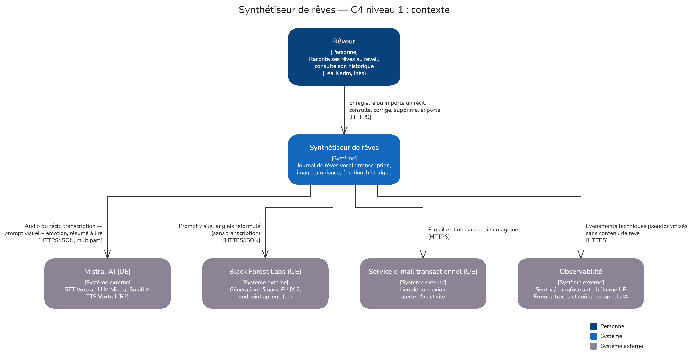
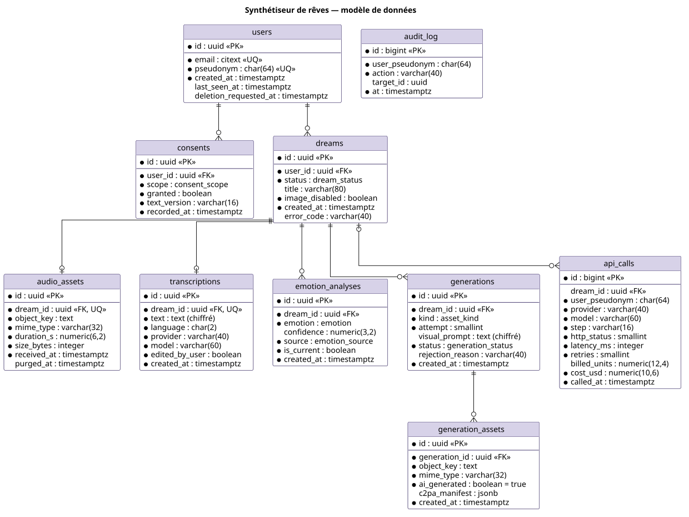

# 1. Architecture : diagrammes C4



```{=latex}
% Rendu Eisvogel : schéma très large, page à l'italienne dédiée.
\begin{landscape}\thispagestyle{empty}
\begin{figure}[H]\centering
\includegraphics[width=\linewidth,height=0.9\textheight,keepaspectratio]{c4_container.png}
\caption{C4 niveau 2 — conteneurs de l'architecture cible de production}
\end{figure}
\end{landscape}
```

## Maquette ≠ cible
| | Maquette (pré-production) | Cible (production) |
|-------------------------------|---------------------------------------------|--------------------------------------------|
| Front | Streamlit, un processus | Streamlit jusqu'à la bêta, puis **Next.js** après R3 si la revue de R2 le confirme : enregistrement audio natif fiable sur mobile, contrôle fin de l'accessibilité et du cache, déploiement statique sur CDN |
| Logique | `src/dreamsynth`, appelé en synchrone | Même code métier dans un **worker** asynchrone |
| Stockage | `st.session_state` | PostgreSQL 16 + stockage objet S3-compatible, tous deux hébergés dans l'UE et chiffrés |
| Fournisseurs | Adapters `mock` (réels branchables par variable d'environnement) | Adapters Mistral et BFL |

## Pourquoi un traitement asynchrone
Un rêve enchaîne trois appels externes dont les p95 visés totalisent 27 s (28 s avec l'accusé de réception, ADR-006) : impossible à tenir dans une requête HTTP sans bloquer un processus web et sans perdre le travail à la moindre coupure réseau. L'API répond `202 Accepted` en moins d'une seconde (ENF-04) ; un worker Arq consomme la file Redis ; le front interroge l'état du rêve.

## Scalabilité

- **Workers horizontaux, sans état** : la capacité croît par ajout de réplicas ; le goulot attendu est le quota des fournisseurs (24 requêtes simultanées chez BFL), pas le CPU — c'est ce que vérifie le plan de charge (ENF-12).
- **Idempotence** : clé de job = `dream_id` et verrou en base ; un job rejoué après crash reprend à la dernière étape terminée sans refacturer un appel déjà payé.
- **Backpressure** : file bornée (au-delà de 200 jobs en attente, l'API répond `503 retry_after`) ; concurrence par fournisseur plafonnée par sémaphore ; un `429` fournisseur suspend l'étape avec backoff au lieu d'échouer.
- **Quotas par utilisateur** : 5 rêves par jour, 2 générations d'image par rêve, coupe-circuit budgétaire global (ADR-007). File bornée, quotas et limites de débit sont des paramètres de conception, recalibrés par le test de charge.

## Sécurité (OWASP ASVS niveau 1)

- **Authentification** sans mot de passe par lien magique à usage unique (15 min) ; cookie de session `Secure`, `HttpOnly`, `SameSite=Lax` ; expiration à 30 jours d'inactivité.
- **Autorisation** : chaque requête filtre par `user_id` de la session ; aucun identifiant de rêve n'est accepté sans contrôle de propriété (test automatisé par endpoint).
- **Entrées** : type MIME vérifié par signature d'octets et non par extension, taille ≤ 20 Mo, durée 3–300 s, schémas Pydantic stricts sur tout JSON.
- **Secrets** dans le gestionnaire de secrets de l'hébergeur, jamais dans le dépôt (`.env.example` seul versionné, détection de secrets en pre-commit).
- **Limitation de débit** : 30 requêtes/min par session, 5 envois audio/jour par compte.
- **Chiffrement** : TLS 1.2+ partout ; chiffrement au repos de la base et du stockage objet ; colonnes `transcriptions.text` et `generations.visual_prompt` chiffrées applicativement (clé hors base).
- **Diffusion des médias** : URL signées de 15 min via le CDN, jamais d'objet public.

# 2. Modèle de données



## Dictionnaire d'attributs
Conventions communes : `id` UUID v4 généré côté serveur (sauf `api_calls` et `audit_log` : `bigint` séquentiel) ; `created_at timestamptz NOT NULL DEFAULT now()` ; clés étrangères `ON DELETE CASCADE`, sauf `api_calls.dream_id` (`SET NULL`, pour conserver les coûts sans le contenu). Sensibilité : **S** = catégorie particulière potentielle (art. 9) · **P** = donnée personnelle · **T** = technique.

| Table.attribut | Type | Null | Contrainte | Sens. | Conservation |
|-------------------------------------------|------------------|-------|---------------------------|--------|------------------|
| users.email | citext | non | unique | P | Durée du compte |
| users.pseudonym | char(64) | non | unique, HMAC-SHA256(id, clé secrète) | P | Durée du compte |
| users.last_seen_at | timestamptz | oui | — | P | Sert au délai d'inactivité de 24 mois |
| users.deletion_requested_at | timestamptz | oui | demande d'effacement ; purge physique < 24 h (ENF-07), pas de suppression logique | P | ≤ 24 h |
| consents.scope | enum | non | `transcription`, `image_generation`, `emotion_tracking` | P | Compte + 5 ans (preuve) |
| consents.granted / text_version | boolean / varchar(16) | non | une ligne par changement (historique) | P | Compte + 5 ans |
| dreams.status | enum | non | `received` → `transcribed` → `analyzed` → `done` / `failed` | T | Durée du rêve |
| dreams.title | varchar(80) | oui | produit par le LLM, modifiable | S | Durée du rêve |
| dreams.image_disabled | boolean | non | défaut `false` (US-11) | P | Durée du rêve |
| dreams.error_code | varchar(40) | oui | code de la table §4, jamais de message fournisseur brut | T | Durée du rêve |
| audio_assets.object_key | text | non | clé S3 aléatoire, sans nom de fichier d'origine | S | **≤ 24 h** |
| audio_assets.duration_s / size_bytes | numeric(6,2) / integer | non | 3–300 s / ≤ 20 Mo | T | Durée du rêve |
| audio_assets.purged_at | timestamptz | oui | renseigné à la suppression de l'objet | T | Durée du rêve |
| transcriptions.text | text | non | **chiffré** applicativement, 1–20 000 car. | S | Durée du rêve |
| transcriptions.provider / model | varchar | non | traçabilité du modèle | T | Durée du rêve |
| transcriptions.edited_by_user | boolean | non | US-05 | T | Durée du rêve |
| emotion_analyses.emotion | enum | non | 6 valeurs (`Emotion`) | S | Durée du rêve |
| emotion_analyses.confidence | numeric(3,2) | oui | 0–1, nul si source utilisateur | T | Durée du rêve |
| emotion_analyses.source / is_current | enum / boolean | non | `model` / `user` ; une seule ligne courante par rêve | T | Durée du rêve |
| generations.kind / attempt | enum / smallint | non | `image`, `ambiance`, `speech`, `video` ; attempt ≤ 2 | T | Durée du rêve |
| generations.visual_prompt | text | oui | **chiffré** ; anglais, sans donnée identifiante | S | Durée du rêve |
| generations.status / rejection_reason | enum / varchar(40) | non / oui | `ok`, `skipped`, `rejected`, `failed` | T | Durée du rêve |
| generation_assets.object_key | text | non | copie dans notre stockage (jamais d'URL fournisseur) | S | Durée du rêve |
| generation_assets.ai_generated | boolean | non | toujours `true` (art. 50 AI Act) | T | Durée du rêve |
| generation_assets.c2pa_manifest | jsonb | oui | manifeste C2PA (R2) | T | Durée du rêve |
| api_calls.user_pseudonym | char(64) | non | jamais l'`id` ni l'e-mail | P | 6 mois |
| api_calls.step / provider / model | varchar | non | `stt`, `llm`, `image`, `tts` | T | 6 mois |
| api_calls.latency_ms / retries / http_status | integer / smallint | non | SLI d'ADR-006 | T | 6 mois |
| api_calls.billed_units / cost_usd | numeric | oui / non | unités facturées (s audio, tokens, MP) et coût calculé | T | 6 mois |
| audit_log.action / target_id | varchar(40) / uuid | non / oui | `consent.update`, `dream.delete`, `account.delete`, `export` | P | 6 mois |

## Schéma JSON d'un rêve stocké
`docs/schemas/dream.schema.json` (JSON Schema 2020-12) est **généré** depuis les modèles Pydantic de `src/dreamsynth/domain/models.py` (`python tools/export_schema.py`) ; la CI échoue s'il n'est pas à jour (`--check`). Il décrit le format d'export (US-15) : `DreamExport { schema_version, exported_at, dreams[] }`, chaque `Dream` portant `audio` (métadonnées seules), `transcription`, `emotion`, `visual_prompt`, `image_disabled` et `assets[]` dont `ai_generated` vaut la constante `true`.

```{=typst}
#page(flipped: true, margin: (x: 1.2cm, top: 1.5cm, bottom: 1.3cm))[
  = 3. Séquence clé : traitement complet d'un rêve
  #grid(columns: (1fr, 6.4cm), gutter: 0.5cm,
    figure(
      image("/docs/preprod/diagrams/sequence_reve.svg", width: 100%, height: 15.2cm, fit: "contain"),
      caption: [Diagramme de séquence UML — traitement d'un rêve, branches d'erreur incluses],
    ),
    [
      #set text(size: 9pt)
      #set par(justify: false)
      *Points de conception*


      - *Validation avant tout stockage* (3–6) : fichier invalide, consentement absent ou quota atteint ne déclenchent aucun appel payant.
      - *Audio éphémère* (21) : supprimé dès la transcription enregistrée ; en cas d'échec définitif, conservé 24 h au plus pour « Relancer », puis purgé.
      - *Retries comptés* (16) : 2 nouvelles tentatives après 0,5 s puis 1 s (backoff exponentiel), sur timeout, `429` et `5xx` ; une ligne `api_calls` par tentative.
      - *Sortie LLM contrôlée* (24) : validée contre `DreamAnalysis`, un second essai, puis échec explicite.
      - *Image ∥ ambiance* (bloc `par`) : sautée si l'utilisateur l'a refusée, sans consentement « image » ou budget épuisé (ADR-007).
      - *Rejet du filtre de sécurité* (28–29) : le rêve aboutit sans image, motif `safety`, sans nouvelle tentative avec un prompt modifié.
      - *Copie immédiate* (31) : l'URL fournisseur expire en 10 min et n'est jamais exposée au navigateur.
    ],
  )
]
```

```{=latex}
% Équivalent LaTeX (rendu Eisvogel) du bloc Typst ci-dessus ; chaque moteur ignore le bloc de l'autre.
\clearpage
\section{3. Séquence clé : traitement complet d'un rêve}
\begin{center}
\includegraphics[width=\linewidth,height=0.86\textheight,keepaspectratio]{sequence_reve.png}\\[2pt]
{\small\itshape Diagramme de séquence UML — traitement d'un rêve, branches d'erreur incluses}
\end{center}
\clearpage
\subsection{Points de conception}
\begin{itemize}\setlength\itemsep{2pt}
\item \textbf{Validation avant tout stockage} (3–6) : fichier invalide, consentement absent ou quota atteint ne déclenchent aucun appel payant.
\item \textbf{Audio éphémère} (21) : supprimé dès la transcription enregistrée ; en cas d'échec définitif, conservé 24 h au plus pour « Relancer », puis purgé.
\item \textbf{Retries comptés} (16) : 2 nouvelles tentatives après 0,5 s puis 1 s (backoff exponentiel), sur timeout, \texttt{429} et \texttt{5xx} ; une ligne \texttt{api\_calls} par tentative.
\item \textbf{Sortie LLM contrôlée} (24) : validée contre \texttt{DreamAnalysis}, un second essai, puis échec explicite.
\item \textbf{Image ∥ ambiance} (bloc \texttt{par}) : sautée si l'utilisateur l'a refusée, sans consentement « image » ou budget épuisé (ADR-007).
\item \textbf{Rejet du filtre de sécurité} (28–29) : le rêve aboutit sans image, motif \texttt{safety}, sans nouvelle tentative avec un prompt modifié.
\item \textbf{Copie immédiate} (31) : l'URL fournisseur expire en 10 min et n'est jamais exposée au navigateur.
\end{itemize}
```

# 4. API : choix argumenté et contrats internes

## API externes retenues
Le benchmark complet (coûts, latences, RGPD, scoring pondéré) est en annexe `benchmark.xlsx` et en section 4 du dossier de cadrage ; chaque choix est une décision tracée.

| Étape | Fournisseur / modèle | Raison principale | Repli | ADR |
|----------------|-----------------------------|---------------------------------|---------------------------|----------------|
| STT | Mistral Voxtral Mini Transcribe 3 | 1ᵉʳ du scoring STT (4,69/5) : moins cher à égalité, UE, DPA publié | Voxtral Small (WER > 10 %) · faster-whisper | ADR-002 |
| Prompt + émotion | Mistral Small 4, JSON Schema | Un seul appel, ≈ 1,4 % du coût, texte seul (AI Act) | mDeBERTa (émotion seule) | ADR-001, 003 |
| Image | BFL FLUX.2 [klein], `api.eu.bfl.ai` | 1ᵉʳ du scoring image (3,45/5), seul acteur UE | FLUX.2 [pro] · Nano Banana 2.1 | ADR-004 |
| Ambiance | Bibliothèque CC0 interne | Coût nul, aucun transfert | — | ADR-005 |
| Voix (R2) | Mistral Voxtral TTS | Même contrat, voix FR | Azure Neural TTS (UE) | ADR-005 |

Tous les fournisseurs sont derrière des **ports** (`Transcriber`, `DreamAnalyzer`, `ImageGenerator`, `SpeechSynthesizer`) : remplacer un modèle déprécié revient à écrire un adapter, sans toucher au métier ni à l'UI.

## Contrats de l'API interne (REST, préfixe `/v1`, JSON UTF-8)
| Méthode et chemin | Rôle | Réponse nominale | Story |
|---------------------------------------------------|---------------------------|--------------------------------|----------|
| `POST /auth/magic-link` | `{email}` → envoi du lien | `204` | — |
| `PUT /me/consents` | `{transcription, image_generation, emotion_tracking, text_version}` | `200` + état courant | US-03 |
| `POST /dreams` | multipart `audio` + `image_disabled` | `202 {dream_id, status_url}` | US-01, 02, 11 |
| `GET /dreams/{id}` | état et contenu d'un rêve | `200 Dream` (URL de médias signées 15 min) | US-04, 06, 07, 08 |
| `PATCH /dreams/{id}` | `{transcription?, emotion?}` ; une transcription modifiée relance l'analyse | `200 Dream` | US-05, 14 |
| `POST /dreams/{id}/retry` | relance l'étape en échec | `202` | US-08 |
| `GET /dreams?emotion=&from=&to=&cursor=` | historique paginé, du plus récent au plus ancien | `200 {items[], next_cursor}` | US-09, 10 |
| `GET /me/stats/emotions?months=6` | répartition mensuelle | `200` | US-16 |
| `DELETE /dreams/{id}` | suppression en cascade | `204` | US-12 |
| `GET /me/export` | export complet | `200 DreamExport` (`dream.schema.json`) | US-15 |
| `DELETE /me` | suppression du compte | `202` (effacement < 24 h) | US-17 |

Exemple — `GET /v1/dreams/{id}` :
```json
{"id": "3f1c…", "status": "done", "title": "Le train sous la mer",
 "transcription": {"text": "J'étais dans un train…", "edited_by_user": false},
 "emotion": {"emotion": "étrange", "confidence": 0.82, "source": "model"},
 "image_disabled": false,
 "assets": [{"kind": "image", "url": "https://cdn…/sig…", "ai_generated": true}]}
```

## Codes d'erreur
Format unique : `{"error": {"code": "…", "message": "texte affichable en français", "action": "retry|record_again|consent|wait"}}`.

| HTTP | `code` | Cas | Action proposée |
|----------|-----------------------------------------------|-------------------------------------|--------------------------|
| 400 | `validation_error` | JSON non conforme au schéma | corriger la saisie |
| 401 | `unauthenticated` | session absente ou expirée | se reconnecter |
| 403 | `consent_required` | finalité non consentie | ouvrir les réglages de consentement |
| 404 | `not_found` | rêve inexistant **ou appartenant à un autre compte** (pas de 403, pour ne rien révéler) | — |
| 413 | `audio_too_large` | > 20 Mo | réenregistrer plus court |
| 415 | `audio_unsupported` | ni WAV ni MP3 (signature d'octets) | convertir ou réenregistrer |
| 422 | `audio_invalid` | durée < 3 s ou > 300 s, fichier illisible | réenregistrer |
| 429 | `quota_exceeded` | 5 rêves/jour atteints (`reset_at` fourni) | attendre |
| 503 | `busy` | file saturée (`retry_after`) | réessayer |
| — | `stt_unavailable`, `llm_invalid_output`, `image_rejected_safety`, `image_budget_exhausted` | statut d'échec d'étape dans `dreams.error_code` | relancer ou continuer sans image |

# 5. Exigences : fonctionnelles, performance, SLO, budget API

Source unique : `docs/backlog/requirements.toml`. Le tableau ci-dessous et la matrice `tracabilite.csv` (exigence → story → test → composant C4) en sont générés ; la génération échoue si une story cite une exigence inexistante ou si une exigence fonctionnelle n'est portée par aucune story.


| ID | Exigence | Stories |
|----------------------|------------------------------------------------------------------------|-------------------------|
| EXF-01 | Enregistrer un récit au micro depuis le navigateur (WAV). | US-01 |
| EXF-02 | Importer un fichier .wav ou .mp3 ; refuser tout autre format, > 20 Mo ou hors 3–300 s. | US-02 |
| EXF-03 | Bloquer tout envoi à un fournisseur sans consentement explicite pour la finalité concernée ; consentements révocables et horodatés. | US-03 |
| EXF-04 | Transcrire le récit en français et afficher la transcription. | US-04 |
| EXF-05 | Permettre la correction de la transcription avant génération. | US-05 |
| EXF-06 | Classer l'émotion dominante à partir du texte parmi 6 classes (heureux, serein, neutre, étrange, mélancolique, stressant), avec icône et couleur. | US-06 |
| EXF-07 | Permettre la correction de l'émotion ; conserver la source (modèle / utilisateur). | US-14 |
| EXF-08 | Générer une image à partir du seul prompt visuel reformulé (jamais de la transcription brute). | US-07 |
| EXF-09 | Marquer chaque contenu généré : mention visible « générée par IA » et métadonnées lisibles par machine. | US-07 |
| EXF-10 | Afficher la progression par étape et, en cas d'échec, un message clair avec une action possible. | US-08 |
| EXF-11 | Option « Ne pas générer d'image » par rêve : aucun appel au générateur d'image. | US-11 |
| EXF-12 | Associer une ambiance sonore à l'émotion du rêve. | US-13 |
| EXF-22 | Lire à voix haute le titre et le résumé du rêve (voix française de synthèse). | US-23 |
| EXF-13 | Appliquer un style visuel choisi au prompt. | US-19 |
| EXF-14 | Produire une micro-vidéo de 5 s maximum à la demande. | US-20 |
| EXF-15 | Lister les rêves de l'utilisateur du plus récent au plus ancien. | US-09 |
| EXF-16 | Filtrer l'historique par émotion et l'afficher sur une frise temporelle. | US-10 |
| EXF-17 | Afficher la répartition mensuelle des émotions avec la mention « sans valeur médicale ». | US-16 |
| EXF-18 | Rappel matinal optionnel, désactivé par défaut. | US-18 |
| EXF-19 | Supprimer un rêve et tous ses fichiers (base, stockage objet, cache CDN). | US-12 |
| EXF-20 | Exporter tous les rêves en JSON valide contre dream.schema.json. | US-15 |
| EXF-21 | Supprimer le compte et toutes les données rattachées ; seul subsiste un journal d'audit pseudonymisé. | US-17 |
| ENF-01 | Latence p95 de l'étape transcription ≤ 8 s pour un récit ≤ 90 s (ADR-006). | US-04 |
| ENF-02 | Latence p95 de l'étape image ≤ 15 s (ADR-006). | US-07 |
| ENF-03 | Taux de rêves en échec ≤ 2 % sur 30 jours glissants ; retries ×2 avec backoff exponentiel (ADR-006). | US-08 |
| ENF-04 | Accusé de réception d'un envoi audio (202) en p95 ≤ 1 s hors transfert réseau (ADR-006). | US-01 |
| ENF-05 | Disponibilité mensuelle de l'API ≥ 99,5 % (ADR-006). | — |
| ENF-06 | Budget API mensuel 25 $ en bêta, alerte à 80 %, coupe-circuit de l'image à 100 %, quota 5 rêves/jour/utilisateur (ADR-007). | — |
| ENF-07 | Effacement effectif sous 24 h, y compris stockage objet et purge CDN ; audio brut supprimé après transcription, 24 h maximum. | US-12, US-17 |
| ENF-08 | Sécurité OWASP ASVS niveau 1 : TLS 1.2+, chiffrement au repos, sessions sécurisées, secrets hors dépôt, limitation de débit. | US-03 |
| ENF-09 | L'émotion est inférée du texte uniquement ; aucun traitement acoustique de la voix (ADR-001). | US-06 |
| ENF-10 | Journaux et traces sans contenu de rêve ; identifiant utilisateur pseudonymisé (HMAC). | — |
| ENF-11 | Latence p95 bout-en-bout (fin d'envoi → image affichée) ≤ 30 s (CS-02, ADR-006). | — |
| ENF-12 | Montée en charge : 50 rêves simultanés traités sans erreur autre que les quotas fournisseurs, par ajout de workers (plan de charge). | — |


Composants C4 de chaque exigence et tests qui la couvrent : annexe `tracabilite.csv`.

## SLO (ADR-006)
| SLI | Cible p95 / taux | Fenêtre |
|-----------------------------------------------------------|----------------------------------|---------------------------|
| Accusé de réception `POST /dreams` | ≤ 1 s | 7 j |
| Transcription · Analyse · Image | ≤ 8 s · ≤ 4 s · ≤ 15 s | 7 j |
| **Première image affichée** (fin d'envoi → image visible) | **≤ 30 s** | 7 j |
| Rêves en échec | ≤ 2 % | 30 j |
| Disponibilité API | ≥ 99,5 % (budget d'erreur : 3 h 36 min/mois) | 30 j |

Ces cibles sont des objectifs de conception : aucune latence fournisseur n'a encore été mesurée (`NON MESURÉ — mock`). La campagne `run_latency.py --live` les confirme ou impose de réviser ADR-006.

## Budget API (ADR-007)
Coût du scénario MVP : 0,0185 $ par rêve, 5,54 $ par mois à 10 rêves/jour, 8,30 $ à l'usage estimé de la bêta (15 rêves/jour ; contient un prix ESTIMÉ). Budget bêta **25 $/mois**, alerte à 20 $, coupe-circuit de la génération d'image à 25 $ (le reste du service continue), quota de 5 rêves/jour par utilisateur, 2 générations d'image maximum par rêve.

# 6. Justification technologique

## Bibliothèques Python retenues et écartées
| Besoin | Retenue | Écartée (raison) |
|--------------------------|-----------------------------------------------------------|-----------------------------------|
| Modèles, validation, schéma JSON | **Pydantic 2** : une classe = validation + schéma généré | dataclasses + jsonschema (deux définitions à maintenir) |
| API | **FastAPI** : OpenAPI générée depuis Pydantic, async natif | Django REST (ORM et admin inutiles ici), Flask (validation à ajouter) |
| Accès base | **SQLAlchemy 2 + Alembic** (migrations versionnées) | ORM Django (couplé au framework) |
| File de tâches | **Arq** sur Redis : async comme httpx, idempotence par `job_id`, tâches planifiées incluses | Celery (synchrone, configuration lourde), RQ (pas d'async) |
| Appels HTTP | **httpx** async + **tenacity** (retries comptés) | SDK de chaque fournisseur (quatre styles d'erreur, dépendances lourdes ; gardés seulement pour le prototypage) |
| Maquette | **Streamlit ≥ 1.40** : `st.audio_input` stable | Streamlit 1.35 du sujet (pas d'enregistrement micro natif stable) |
| Tests | **pytest**, pytest-bdd (Gherkin), pytest-cov, respx (mock httpx), hypothesis (validation audio), `streamlit.testing.v1.AppTest`, Locust (charge) | unittest (verbeux), Selenium pour l'UI (lent, fragile) |
| Qualité | **ruff** (lint + format + docstrings Google), **mypy --strict** | flake8 + black + isort (trois outils pour un) |
| Benchmark | openpyxl (formules vivantes), jiwer (WER) | pandas → Excel (valeurs figées) |
| Observabilité | structlog (JSON), OpenTelemetry, Sentry, Langfuse auto-hébergé UE | traçage IA SaaS hors UE |

## Pipeline CI/CD (GitHub Actions)
`.github/workflows/ci.yml`, sur chaque pull request et sur `main` :

1. `ruff check` et `ruff format --check` ;
2. `mypy --strict src` ;
3. `python tools/backlog.py --check` et `python tools/export_schema.py --check` (backlog cohérent, schéma à jour) ;
4. `pytest --cov=src --cov-fail-under=80` (unitaires, intégration avec mocks, scénarios BDD, AppTest) ;
5. construction de l'image Docker de l'API et du worker, scan des dépendances (`pip-audit`) ;
6. sur `main` uniquement : déploiement en préproduction, test de fumée, puis promotion manuelle en production (environnement protégé).
La protection de branche exige une CI verte et une relecture (section 8 du dossier de cadrage).

## Monitoring

- **Logs structurés** JSON (structlog) : `request_id`, `user_pseudonym`, étape, durée ; filtre qui rejette tout champ `text`, `transcription`, `prompt` — testé (ENF-10).
- **Traces** OpenTelemetry API → file → worker → fournisseur ; un span par appel IA avec fournisseur, modèle, latence, retries, unités facturées et coût (alimente `api_calls` et les SLI d'ADR-006).
- **Erreurs** : Sentry, avec suppression des corps de requête.
- **Tableau de bord** : p95 par étape, taux d'échec, rejets du filtre de sécurité (K5), coût cumulé du mois.
- **Alertes** : p95 bout-en-bout > 30 s sur 1 h ; échecs > 2 % sur 24 h ; budget à 80 % puis 100 % (coupe-circuit automatique, ADR-007) ; fournisseur en erreur > 5 min.
