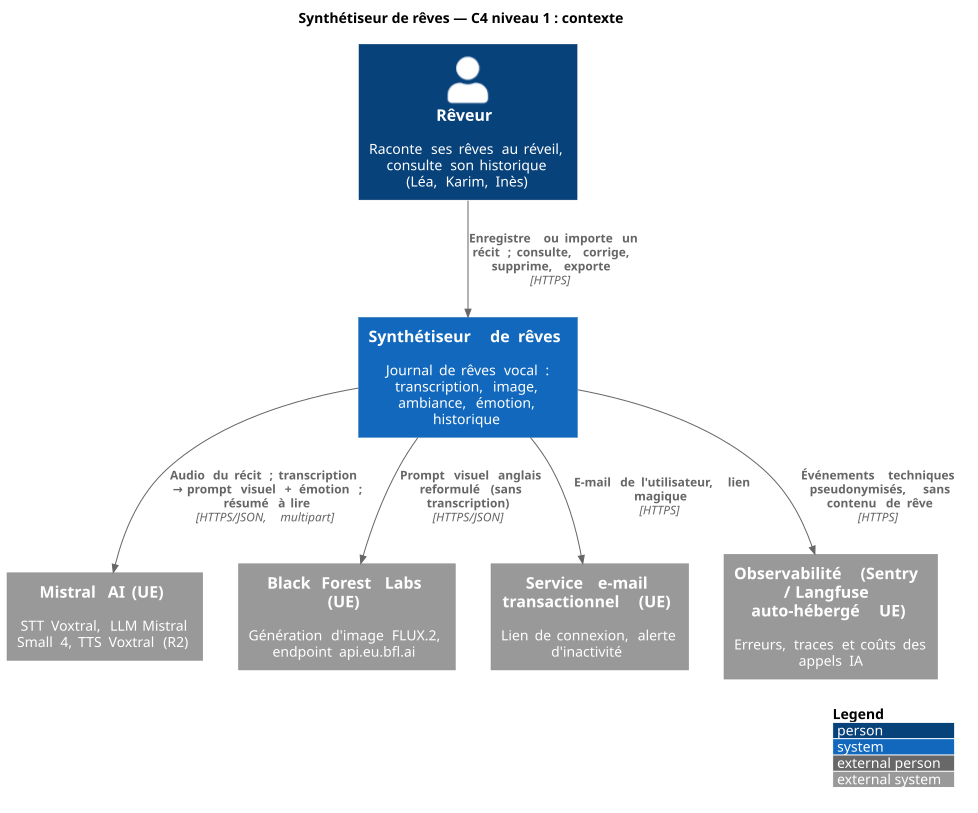
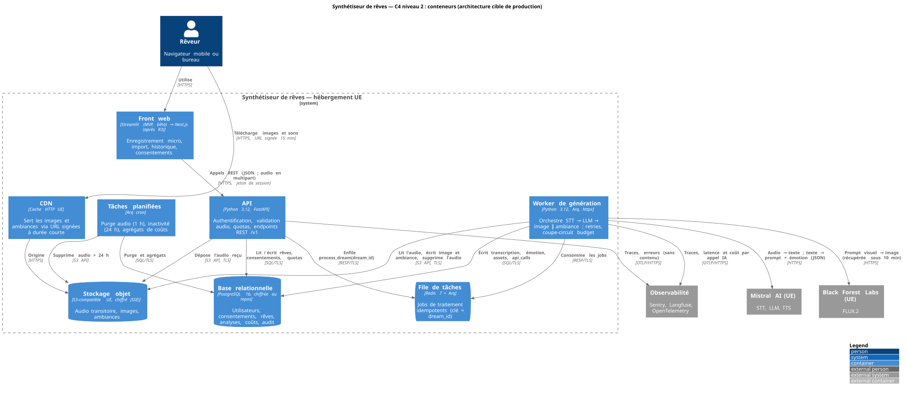

# 1. Architecture : diagrammes C4

## Maquette ≠ cible
| | Maquette (pré-production) | Cible (production) |
|---|---|---|
| Front | Streamlit, un processus | Streamlit jusqu'à la bêta, puis **Next.js** après R3 si la revue de R2 le confirme : enregistrement audio natif fiable sur mobile, contrôle fin de l'accessibilité et du cache, déploiement statique sur CDN |
| Logique | `src/dreamsynth`, appelé en synchrone | Même code métier dans un **worker** asynchrone |
| Stockage | `st.session_state` | PostgreSQL 16 + stockage objet S3-compatible, tous deux hébergés dans l'UE et chiffrés |
| Fournisseurs | Adapters `mock` (réels branchables par variable d'environnement) | Adapters Mistral et BFL |

## Pourquoi un traitement asynchrone
Un rêve enchaîne trois appels externes dont les p95 visés totalisent 27 s (28 s avec l'accusé de réception, ADR-006) : impossible à tenir dans une requête HTTP sans bloquer un processus web et sans perdre le travail à la moindre coupure réseau. L'API répond `202 Accepted` en moins d'une seconde (ENF-04) ; un worker Arq consomme la file Redis ; le front interroge l'état du rêve.

## Scalabilité
- **Workers horizontaux, sans état** : la capacité croît par ajout de réplicas ; le goulot attendu est le quota des fournisseurs (24 requêtes simultanées chez BFL), pas le CPU — c'est ce que vérifie le plan de charge (ENF-12).
- **Idempotence** : clé de job = `dream_id` et verrou en base ; un job rejoué après crash reprend à la dernière étape terminée sans refacturer un appel déjà payé.
- **Backpressure** : file bornée (au-delà de 200 jobs en attente, l'API répond `503 retry_after`) ; concurrence par fournisseur plafonnée par sémaphore ; un `429` fournisseur suspend l'étape avec backoff au lieu d'échouer.
- **Quotas par utilisateur** : 5 rêves par jour, 2 générations d'image par rêve, coupe-circuit budgétaire global (ADR-007). File bornée, quotas et limites de débit sont des paramètres de conception, recalibrés par le test de charge.

## Sécurité (OWASP ASVS niveau 1)
- **Authentification** sans mot de passe par lien magique à usage unique (15 min) ; cookie de session `Secure`, `HttpOnly`, `SameSite=Lax` ; expiration à 30 jours d'inactivité.
- **Autorisation** : chaque requête filtre par `user_id` de la session ; aucun identifiant de rêve n'est accepté sans contrôle de propriété (test automatisé par endpoint).
- **Entrées** : type MIME vérifié par signature d'octets et non par extension, taille ≤ 20 Mo, durée 3–300 s, schémas Pydantic stricts sur tout JSON.
- **Secrets** dans le gestionnaire de secrets de l'hébergeur, jamais dans le dépôt (`.env.example` seul versionné, détection de secrets en pre-commit).
- **Limitation de débit** : 30 requêtes/min par session, 5 envois audio/jour par compte.
- **Chiffrement** : TLS 1.2+ partout ; chiffrement au repos de la base et du stockage objet ; colonnes `transcriptions.text` et `generations.visual_prompt` chiffrées applicativement (clé hors base).
- **Diffusion des médias** : URL signées de 15 min via le CDN, jamais d'objet public.
