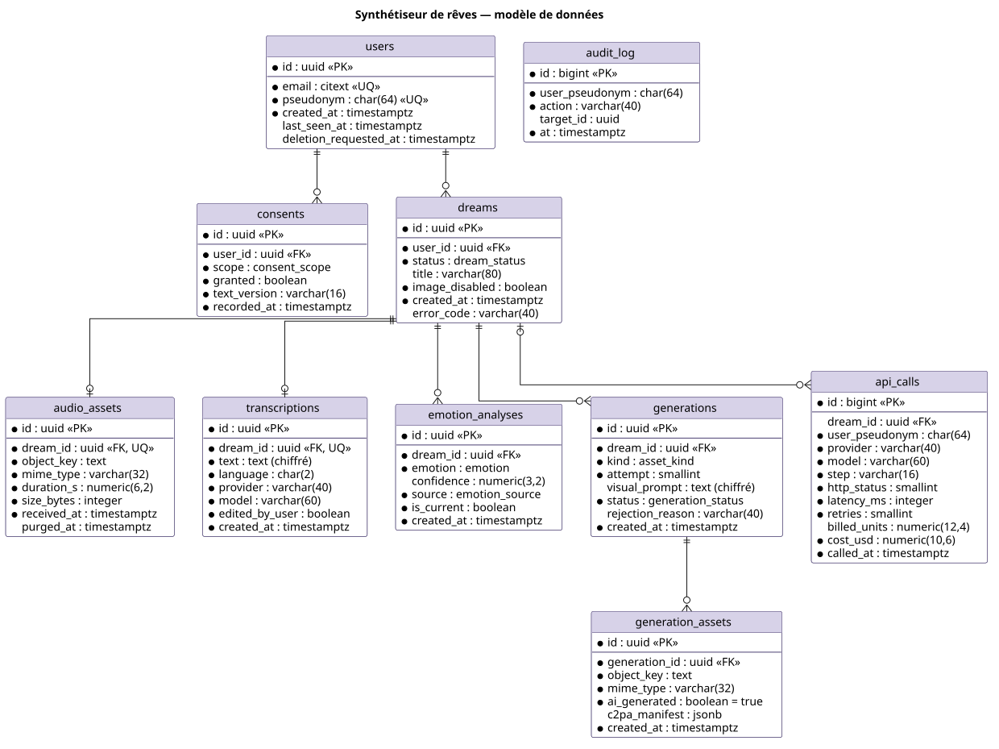

# 2. Modèle de données

## Dictionnaire d'attributs
Conventions communes : `id` UUID v4 généré côté serveur (sauf `api_calls` et `audit_log` : `bigint` séquentiel) ; `created_at timestamptz NOT NULL DEFAULT now()` ; clés étrangères `ON DELETE CASCADE`, sauf `api_calls.dream_id` (`SET NULL`, pour conserver les coûts sans le contenu). Sensibilité : **S** = catégorie particulière potentielle (art. 9) · **P** = donnée personnelle · **T** = technique.

| Table.attribut | Type | Null | Contrainte | Sens. | Conservation |
|---|---|---|---|---|---|
| users.email | citext | non | unique | P | Durée du compte |
| users.pseudonym | char(64) | non | unique, HMAC-SHA256(id, clé secrète) | P | Durée du compte |
| users.last_seen_at | timestamptz | oui | — | P | Sert au délai d'inactivité de 24 mois |
| users.deletion_requested_at | timestamptz | oui | demande d'effacement ; purge physique < 24 h (ENF-07), pas de suppression logique | P | ≤ 24 h |
| consents.scope | enum | non | `transcription`, `image_generation`, `emotion_tracking` | P | Compte + 5 ans (preuve) |
| consents.granted / text_version | boolean / varchar(16) | non | une ligne par changement (historique) | P | Compte + 5 ans |
| dreams.status | enum | non | `received` → `transcribed` → `analyzed` → `done` / `failed` | T | Durée du rêve |
| dreams.title | varchar(80) | oui | produit par le LLM, modifiable | S | Durée du rêve |
| dreams.image_disabled | boolean | non | défaut `false` (US-11) | P | Durée du rêve |
| dreams.error_code | varchar(40) | oui | code de la table §4, jamais de message fournisseur brut | T | Durée du rêve |
| audio_assets.object_key | text | non | clé S3 aléatoire, sans nom de fichier d'origine | S | **≤ 24 h** |
| audio_assets.duration_s / size_bytes | numeric(6,2) / integer | non | 3–300 s / ≤ 20 Mo | T | Durée du rêve |
| audio_assets.purged_at | timestamptz | oui | renseigné à la suppression de l'objet | T | Durée du rêve |
| transcriptions.text | text | non | **chiffré** applicativement, 1–20 000 car. | S | Durée du rêve |
| transcriptions.provider / model | varchar | non | traçabilité du modèle | T | Durée du rêve |
| transcriptions.edited_by_user | boolean | non | US-05 | T | Durée du rêve |
| emotion_analyses.emotion | enum | non | 6 valeurs (`Emotion`) | S | Durée du rêve |
| emotion_analyses.confidence | numeric(3,2) | oui | 0–1, nul si source utilisateur | T | Durée du rêve |
| emotion_analyses.source / is_current | enum / boolean | non | `model` / `user` ; une seule ligne courante par rêve | T | Durée du rêve |
| generations.kind / attempt | enum / smallint | non | `image`, `ambiance`, `speech`, `video` ; attempt ≤ 2 | T | Durée du rêve |
| generations.visual_prompt | text | oui | **chiffré** ; anglais, sans donnée identifiante | S | Durée du rêve |
| generations.status / rejection_reason | enum / varchar(40) | non / oui | `ok`, `skipped`, `rejected`, `failed` | T | Durée du rêve |
| generation_assets.object_key | text | non | copie dans notre stockage (jamais d'URL fournisseur) | S | Durée du rêve |
| generation_assets.ai_generated | boolean | non | toujours `true` (art. 50 AI Act) | T | Durée du rêve |
| generation_assets.c2pa_manifest | jsonb | oui | manifeste C2PA (R2) | T | Durée du rêve |
| api_calls.user_pseudonym | char(64) | non | jamais l'`id` ni l'e-mail | P | 6 mois |
| api_calls.step / provider / model | varchar | non | `stt`, `llm`, `image`, `tts` | T | 6 mois |
| api_calls.latency_ms / retries / http_status | integer / smallint | non | SLI d'ADR-006 | T | 6 mois |
| api_calls.billed_units / cost_usd | numeric | oui / non | unités facturées (s audio, tokens, MP) et coût calculé | T | 6 mois |
| audit_log.action / target_id | varchar(40) / uuid | non / oui | `consent.update`, `dream.delete`, `account.delete`, `export` | P | 6 mois |

## Schéma JSON d'un rêve stocké
`docs/schemas/dream.schema.json` (JSON Schema 2020-12) est **généré** depuis les modèles Pydantic de `src/dreamsynth/domain/models.py` (`python tools/export_schema.py`) ; la CI échoue s'il n'est pas à jour (`--check`). Il décrit le format d'export (US-15) : `DreamExport { schema_version, exported_at, dreams[] }`, chaque `Dream` portant `audio` (métadonnées seules), `transcription`, `emotion`, `visual_prompt`, `image_disabled` et `assets[]` dont `ai_generated` vaut la constante `true`.
