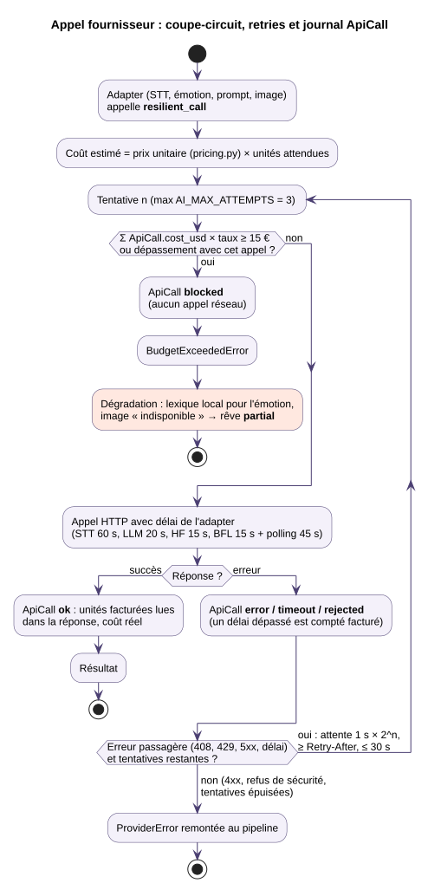
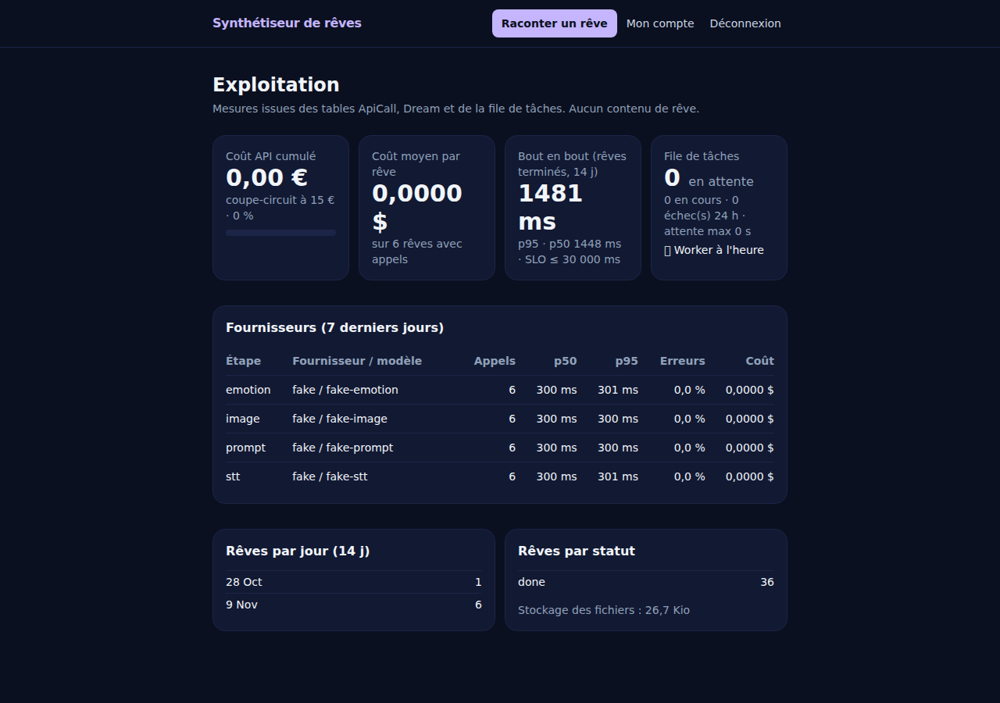

> **Accès.** Code : <https://github.com/BrownGreg/dream> (branches, PR et CI publiques) · Suivi : Jira, projet **DREAM**, epic DREAM-41 ; les références DREAM-1 à 24 des branches et PR correspondent aux clés Jira DREAM-42 à 65 (table dans `docs/backlog/README.md`, export dans `docs/backlog/jira_production.csv`) · Production : <https://dreamsynth.onrender.com>, déployée le 15/11/2026 (Render, Francfort ; base Neon, UE), redéployée automatiquement depuis `main` après une CI verte · Toutes les valeurs de ce rapport sont tirées d'un fichier de mesure du dépôt, cité à chaque fois. Ce qui n'a pas pu être mesuré est marqué **NON MESURÉ**, avec sa cause, et n'est pas estimé à la place.

# 1. Le produit livré

L'utilisateur dicte un rêve (micro du navigateur ou fichier audio). Un worker, hors de la requête HTTP, le transcrit, en déduit l'émotion dominante **à partir du texte**, rédige un prompt visuel puis génère une image onirique stockée chez nous. Le rêve rejoint un historique filtrable et un tableau de bord personnel. Une ambiance sonore accordée à l'émotion est proposée en bonus.

| Fonctionnalité | Ticket(s) | État |
|---|---|---|
| Inscription, connexion, réinitialisation, consentements séparés (traitement, image) | DREAM-1, DREAM-14 | Livré, testé |
| Enregistrement micro et import audio validés (format, durée, taille) | DREAM-6, DREAM-19 | Livré, parcours E2E micro simulé |
| Transcription Voxtral | DREAM-7 | Livré, **vérifié en production** le 15/11/2026 : 3 transcriptions réelles réussies (0,86 à 0,91 s) après activation du plan API Mistral (incident n° 15) |
| Émotion : Hugging Face → Mistral → lexique français | DREAM-8 | Livré ; en production, Hugging Face répond 402 (compte sans crédit) et le **repli Mistral** prend le relais à chaque fois (3 sur 3, 0,44 à 0,48 s) |
| Prompt visuel Mistral Small et image FLUX.2 [klein] | DREAM-9 | Livré, **vérifié en production** : prompt 1,3 à 2,0 s ; image générée en 8,7 s pour 1,4 crédit BFL, après deux refus 402 (compte non crédité) gérés par le message « image non créée, vous pourrez la régénérer » |
| Traitement en tâche de fond idempotent, reprise par étape, suivi HTMX | DREAM-10 | Livré |
| Historique paginé, filtres date et humeur, statistiques | DREAM-11, DREAM-12 | Livré |
| Détail : corriger le récit, régénérer l'image, supprimer | DREAM-13 | Livré |
| Export ZIP/JSON et suppression du compte (RGPD) | DREAM-14 | Livré |
| Ambiance sonore (bonus, non générative) | DREAM-15 | Livré |
| Accessibilité WCAG 2.2 AA, mobile d'abord | DREAM-16 | Livré : audit axe-core sans violation sur 10 pages |
| Observabilité : journaux JSON, Sentry, `/health`, `/ops` | DREAM-17 | Livré |
| Déploiement Render automatisé depuis `main` | DREAM-2 | Livré le 15/11/2026 : deploy hook appelé par la CI avec le commit testé, puis attente que `/health` annonce ce commit (incidents n° 13 et 14) |

# 2. Architecture finale

## 2.1 Évolution depuis le bloc 1

L'architecture cible du bloc 1 (FastAPI, Streamlit puis Next.js, Arq sur Redis, stockage S3) a été révisée par l'**ADR-008** pour respecter le sujet de production (Django, SQL, Tailwind) et tenir en 6 jours pour une personne seule.

| Brique | Bloc 1 | Production | Décision |
|---|---|---|---|
| Web | FastAPI + Streamlit → Next.js | Django 6.0 monolithe, gabarits + HTMX + Tailwind | ADR-008 |
| File de tâches | Arq + Redis | `django.tasks` + backend base de données (`db_worker`) | ADR-008 |
| Suivi | sondage du statut | polling HTMX toutes les 2 s | ADR-008 |
| Stockage des fichiers | S3 | PostgreSQL (audio puis images) | ADR-010 |
| Émotion | Mistral Small | Hugging Face → Mistral JSON → lexique | ADR-008 |
| Budget | 25 $/mois, coupe-circuit 100 % | 20 € au total, coupe-circuit à 15 € | ADR-009 |
| Observabilité | OpenTelemetry | structlog JSON + Sentry nettoyé + `ApiCall` + `/ops` | ADR-008 |

Maintenus : ports et adapters (adapter réel ou `fake` choisi par `AI_MODE`), idempotence du traitement, suppression de l'audio après transcription réussie, mention « générée par IA » sur chaque image, émotion inférée du texte et jamais de la voix (ADR-001).

```{=latex}
\begin{landscape}\thispagestyle{empty}
\subsection{2.2 Conteneurs (C4)}
\begin{figure}[H]\centering
\includegraphics[width=\linewidth,height=0.82\textheight,keepaspectratio]{c4_container.pdf}
\caption{Diagramme C4 des conteneurs, régénéré depuis le code livré (\texttt{docs/diagrams/c4\_container.puml})}
\end{figure}
\end{landscape}
```

Un seul conteneur applicatif porte le serveur web (gunicorn) et le worker (`db_worker`), lancés par honcho : Render n'a pas de worker gratuit (ADR-008). PostgreSQL porte à la fois les données, la file de tâches et les fichiers. Les vues ne parlent jamais à un SDK fournisseur : elles passent par `dreams/services`.

```{=latex}
\begin{landscape}\thispagestyle{empty}
\subsection{2.3 Traitement d'un rêve (séquence)}
\begin{figure}[H]\centering
\includegraphics[width=\linewidth,height=0.82\textheight,keepaspectratio]{sequence_reve.pdf}
\caption{Séquence du traitement complet d'un rêve (\texttt{docs/diagrams/sequence\_reve.puml})}
\end{figure}
\end{landscape}
```

La requête d'envoi valide l'audio, crée le rêve et met la tâche en file **après le commit** (`on_commit`) : elle répond en 50 à 60 ms (p50, §5). Chaque étape enregistre son résultat avant la suivante ; une reprise après plantage repart de l'étape échouée sans rejouer un appel déjà payé. Le modèle de données est généré depuis les modèles Django (`scripts/export_erd.py` → `docs/diagrams/erd.svg`).

# 3. Appels API, quotas et erreurs

## 3.1 Fournisseurs et politique d'appel

Tous les appels passent par un client unique, `resilient_call` (`dreams/services/http.py`) : contrôle du budget, délai, retries, journal `ApiCall`. Valeurs lues dans le code (`dreams/services/adapters/`, `config/settings/base.py`, `dreams/services/pricing.py`).

| Étape | Fournisseur, modèle | Délai | Retries | Repli si échec | Prix unitaire (statut) |
|---|---|---|---|---|---|
| Transcription | Mistral `voxtral-mini-transcribe-3` | 60 s (connexion 5 s) | 3 tentatives | rêve `failed` avec un message clair ; l'audio n'est supprimé qu'après une transcription réussie | 0,0035 $/min (SOURCÉ) |
| Émotion 1 | Hugging Face `mDeBERTa-v3-base-mnli-xnli` | 15 s | 3 | Mistral | non publié (facturé au calcul) |
| Émotion 2 | Mistral `mistral-small-2603`, sortie JSON | 20 s | 2 | lexique français local, gratuit, ne peut pas échouer | 0,15 $ / M jetons (SOURCÉ) |
| Prompt visuel | Mistral `mistral-small-2603` | 20 s | 2 | image non générée, rêve `partial` | 0,15 $ / M jetons (SOURCÉ) |
| Image | BFL `flux-2-klein-4b` | 15 s + polling 45 s | 2 | refus de sécurité : **une** reformulation adoucie ; sinon `partial` | crédits lus dans la réponse, 1 crédit = 0,01 $ (SOURCÉ) |

**Règles communes.** Seules les erreurs passagères sont rejouées : délai dépassé, 408, 429, 5xx. Les 4xx et les refus de sécurité ne le sont jamais. L'attente vaut 1 s × 2^n, au moins le `Retry-After` du fournisseur, au plus 30 s. Un délai dépassé est journalisé **comme facturé**, car la requête a pu aboutir chez le fournisseur. Les unités réellement facturées sont lues dans la réponse quand elle les donne (minutes Voxtral, jetons Mistral, crédits BFL) : le coût journalisé est alors mesuré, pas estimé.

## 3.2 Budget et coupe-circuit (ADR-009)

Le sujet plafonne les dépenses API de production à 20 €. Le code coupe à **15 €** cumulés (`AI_BUDGET_EUR`) pour garder 5 € de marge face à l'écart entre estimé et facturé et aux appels en vol. Une alerte s'affiche sur `/ops` à 80 % (12 €). Le taux USD → EUR est fixé à 1,0, ce qui surestime le coût tant que le dollar vaut moins d'un euro. S'y ajoutent un quota de 5 rêves par jour et par utilisateur, remis à zéro à minuit (heure de Paris), et 2 générations d'image au plus par rêve.



Le contrôle a lieu **avant chaque tentative**, retries compris. Budget atteint, aucune requête ne part : l'appel est journalisé `blocked` et le traitement se dégrade sans tomber en panne (lexique pour l'émotion, image « indisponible », rêve `partial`). Tests : `test_budget.py`, `test_resilient_client.py::test_coupe_circuit_…`, incident n° 3 (§7).

## 3.3 Coût

| Indicateur | Valeur | Source |
|---|---|---|
| Coût réel consommé en production | **0,019 $** pour 25 appels le 15/11/2026, dont 0,014 $ pour l'unique image ; les 14 appels refusés (429, 402) sont journalisés à 0 $ | `docs/tests/production/apicall_2026-11-15.json` |
| Coût réel d'un rêve complet | **0,0158 $** pour un récit de 29,9 s : transcription 0,0017 $, émotion 0,00003 $, prompt 0,00007 $, image 0,014 $ (1,4 crédit) | même fichier, rêve de 10 h 48 UTC |
| Coût estimé par rêve (1 min d'audio, émotion par HF) | ≈ 0,018 $ : STT 0,0035 + prompt 900 jetons 0,000135 + image 1,4 crédit 0,014 | constantes du code (`ESTIMATED_CREDITS`, `estimated_tokens`, `pricing.py`) — ESTIMÉ |
| Projection mensuelle, bêta à 15 rêves/jour (ADR-007) | ≈ 7 $/mois (450 rêves × 0,0158 $), récits d'environ 30 s | coût réel ci-dessus ; un récit d'une minute double la part transcription (+0,0017 $) |
| Rêves finançables avant coupe-circuit | ≈ 950 au coût réel | 15 € ÷ 0,0158 $ au taux 1,0 |
| Coût des tests, de la CI et de la charge | 0 € | `AI_MODE=fake` partout ; cassettes VCR en `record_mode=none` |

# 4. Stratégie de tests et résultats

Stratégie complète : `docs/tests/strategie.md`. Principes : aucun appel réel en CI ni en charge ; les adapters `fake` passent par le **même** client résilient que les vrais, si bien que retries, journal et coupe-circuit sont testés sans dépenser ; un bug corrigé donne un test de non-régression (§7) ; données synthétiques uniquement.

## 4.1 Résultats (CI de `main` au 15/11/2026, run `43707491282`)

| Niveau | Outils | Résultat |
|---|---|---|
| Unitaires et intégration (PostgreSQL 17) | pytest, pytest-django, respx, factory_boy | **297 réussis**, 5 ignorés (cassettes VCR non enregistrées, par choix : §9) |
| Navigateur | Playwright Chromium, axe-core 4.14.0 | **3 réussis** : audit WCAG 2.2 AA de 10 pages à 390 px, parcours inscription → micro simulé → résultat → historique |
| Image Docker | Docker Compose | build, migrations, `/health`, page de connexion, statiques : réussi |
| Lint et types | ruff (PEP 8, docstrings Google), mypy strict | réussi |
| Couverture globale | pytest-cov (lignes et branches) | **99 %** de 2 028 instructions |

## 4.2 Couverture par fonctionnalité critique

La CI échoue si une fonctionnalité passe sous 70 % (`scripts/check_coverage.py`, artefact `couverture`).

| Fonctionnalité critique | Couverture |
|---|---|
| Authentification et consentement | 100 % |
| Upload et validation audio | 97,9 % |
| Pipeline et reprise par étape | 97,3 % |
| Pipeline IA : adapters | 100 % |
| Client résilient (délais, retries) | 100 % |
| Garde-fou budget et quotas | 100 % |
| Données sensibles chiffrées | 100 % |
| Stockage et accès aux fichiers | 98,8 % |
| Tableau de bord : historique, filtres, statistiques | 100 % |
| Suppression et export RGPD | 98,7 % |
| Observabilité (journaux, Sentry, `/ops`) | 98,6 % |
| Santé de l'application | 100 % |

## 4.3 Test de charge (Locust)

Paliers de 90 s à 5, 20 puis 50 utilisateurs, adapters `fake` avec 1 000 ms de latence simulée par appel (4 appels par rêve), runner GitHub de 2 vCPU (`docs/tests/charge/`).

| Mesure | 5 utilisateurs | 20 utilisateurs | 50 utilisateurs |
|---|---|---|---|
| Requêtes HTTP, p50 / p95 (1 worker) | 13 / 59 ms | 11 / 50 ms | 10 / 355 ms |
| Taux d'erreur | 0 % | 0 % | 0 % |
| Bout en bout p95, 1 worker | 8,1 s | 34,2 s | 72,4 s |
| Bout en bout p95, 3 workers | 7,4 s | 8,2 s | 24,2 s |
| File max (1 worker) | 1 | 12 | 39 |

**Goulot :** l'attente en file, pas le serveur web. Un worker traite environ 14 rêves par minute avec 4 s de traitement simulé ; au-delà, les rêves attendent. À 3 workers, l'attente p95 passe de 156 s à 18,8 s. Rêves traités : 94 avec 1 worker, 0 en échec.

**Limites :** latences fournisseurs simulées (1 s par appel). En production, le traitement réel d'un rêve avec image dure 14,6 s (§5) au lieu de 4 s simulées : un worker traiterait donc environ 4 rêves par minute au lieu de 14.

# 5. Performance face aux SLO (ADR-006)

Détail : `docs/tests/performance.md`.

| SLO | Cible | Mesure | Statut |
|---|---|---|---|
| Accusé de réception de l'envoi | p95 ≤ 1 s | 77 à 178 ms selon le palier | Tenu jusqu'à 50 utilisateurs |
| Bout en bout | p95 ≤ 30 s | **production** : 4,1 s sans image, 14,6 s avec image (2 rêves) ; charge simulée : ≤ 30 s jusqu'à 5 utilisateurs (1 worker), jusqu'à 50 (3 workers) | Tenu en production ; **partiel** sous charge |
| Transcription | p95 ≤ 8 s | **production** : 0,86 à 0,91 s (3 appels, récits de 22 à 29 s) | Tenu (petit échantillon) |
| Analyse LLM | p95 ≤ 4 s | **production** : émotion 0,44 à 0,48 s (3), prompt 1,28 à 1,96 s (3) | Tenu (petit échantillon) |
| Image | p95 ≤ 15 s | **production** : 8,7 s (1 image) | Tenu (1 mesure) |
| Fiabilité | ≤ 2 % de rêves `failed` | 0 / 224 en charge | Tenu en simulation |
| Disponibilité | ≥ 99,5 % de réponses non-5xx | 0 erreur sur 5 012 requêtes en charge | Tenu en charge |

Mesures de production : `docs/tests/production/apicall_2026-11-15.json` (25 appels, 2 rêves aboutis). L'échantillon est trop petit pour un vrai p95 : les valeurs données sont des minimums et maximums. Elles sont toutes **sous les cibles d'ADR-006**, qui prévoyaient 27 s de traitement ; le rêve complet en demande 14,6 s, dont 8,7 s pour l'image. Un worker traiterait donc environ 4 rêves par minute : assez pour la bêta (15 rêves par jour), un pic d'envois simultanés demandant plusieurs workers.

# 6. Monitoring, journaux et métriques

| Outil | Contenu | Garde-fou données |
|---|---|---|
| structlog (JSON en production) | `request_id`, `dream_id`, étape, fournisseur, durée, statut, coût | clés sensibles masquées avant écriture (`config/observability.py`) ; **aucun contenu de rêve** |
| Sentry | exceptions et traces | variables locales désactivées, `before_send` masque les mêmes champs |
| `ApiCall` | une ligne par tentative : fournisseur, modèle, étape, durée, statut HTTP, unités, coût, issue (`ok`, `error`, `timeout`, `rejected`, `blocked`) | utilisateur pseudonymisé (HMAC-SHA256) |
| `/health` | base joignable, worker à l'heure, commit déployé (`release`) | 503 si la base tombe, `degraded` si la file prend du retard ; la CI attend le commit qu'elle a testé |
| `/ops` (staff) | latence p50/p95, volume, taux d'erreur et coût par fournisseur ; budget consommé ; file ; rêves par jour ; bout en bout | réservé au staff, testé |

Test `test_observability.py` : un récit de rêve passé dans une requête n'apparaît ni dans les journaux, ni dans l'événement Sentry.



# 7. Difficultés rencontrées et solutions

Journal tenu au fil de l'eau : `docs/incidents.md` (16 entrées). Format : symptôme → diagnostic → correctif → test de non-régression → PR.

| # | Ticket | Symptôme | Diagnostic | Correctif | Test de non-régression |
|--|------------|--------------|--------------|------------|----------------|
| 1 | DREAM-1 | `Lea@Example.org` et `lea@…` donnent deux comptes | `normalize_email` ne met en minuscules que le domaine | minuscules + refus d'un doublon `iexact` | `test_inscription_refuse_un_doublon_a_la_casse_pres` |
| 2 | DREAM-1 | Axes journalise `username: "None"` ; blocage par IP seule | Axes lit `email`, le formulaire poste `username` | `AXES_USERNAME_FORM_FIELD = "username"` | `test_un_autre_compte_n_est_pas_bloque_…` |
| 3 | DREAM-5 | à 15,00 € pile, un appel à coût nul passe encore | comparaison stricte `>` | blocage dès `dépensé ≥ plafond` | `test_depassement_atteint` |
| 4 | DREAM-7 | WAV sain refusé comme illisible | ffprobe sur l'entrée standard : durée indéterminable | fichier temporaire avant ffprobe | `test_formats_navigateurs_…[reve_court.wav]` |
| 5 | DREAM-7 | CI rouge, `audio_tool_missing` | ffmpeg absent du runner | installation dans le job | tests audio en CI |
| 6 | DREAM-10 | suite tuée (code 137) sans message | `connection.cursor` simulé pour tout Django → boucle infinie | simulation limitée à `dreams.locks` | `test_verrou_postgres_deja_pris` (< 0,1 s) |
| 7 | DREAM-16 | « Mot de passe oublié » affiche le titre de l'admin Django | `admin` avant `accounts` dans `INSTALLED_APPS` | ordre inversé | `test_pages_mot_de_passe_utilisent_nos_gabarits_…` |
| 8 | DREAM-12 | build Docker rouge : `.map` manquant | `sourceMappingURL` de Chart.js exigé par le stockage de production | ligne retirée, empreintes documentées | `test_collectstatic_manifest_de_production` |
| 9 | DREAM-19 | **Critique** : tout enregistrement micro Chrome/Firefox refusé | MediaRecorder écrit en flux, sans durée dans les métadonnées | décodage complet si la durée manque | `test_webm_de_mediarecorder_sans_duree_…` + parcours E2E |
| 10 | DREAM-20 | file de 36 tâches mais « attente max 0 s » | `run_after` vaut la date **maximale**, pas « maintenant » | `DBTaskResult.objects.ready()` ; fixture fidèle | `test_health_degrade_si_le_worker_est_en_retard` |
| 11 | DREAM-17 | « bout en bout p95 » = 1 054 800 001 ms | mesure `updated_at − created_at` | champ `finished_at` fixé une seule fois | `test_bout_en_bout_mesure_le_premier_traitement_seulement` |
| 12 | DREAM-24 | clone propre : `install.sh` échoue à `migrate`, 121 tests rouges | `DATABASE_URL=` vide dans `.env.example` ; la valeur par défaut ne s'applique que si la variable est absente | une valeur vide retombe sur SQLite | `test_database_url_vide_donne_sqlite` |
| 13 | DREAM-2 | premier déploiement Render en échec | `DATABASE_URL` collée avec ses guillemets : moteur non reconnu | valeur sans guillemets | — (configuration de plateforme) |
| 14 | DREAM-2 | « Production OK » 0,2 s après le deploy hook | le test interrogeait l'ancienne instance, encore en ligne pendant le build | `/health` donne le commit ; la CI l'attend | `test_health_donne_le_commit_deploye` |
| 15 | DREAM-7 | en production, toute transcription échoue (429) | organisation Mistral sur le plan Free : 0 requête/min malgré 10 € de crédits | plan API activé | — (compte fournisseur) ; 429 couvert par `test_resilient_client.py` |
| 16 | DREAM-5 | quota atteint après un seul rêve abouti | les échecs `provider_error` (n° 15) comptaient dans le quota | échecs imputables au service exclus | `test_echec_du_service_ne_consomme_pas_le_quota` |

Huit incidents (5, 8, 9, 12 à 16) ne se voyaient pas en développement : seuls la CI, le build de production, un vrai navigateur, un clone propre ou la **production elle-même** les ont révélés. Les quatre derniers datent du premier jour en ligne, avec les vrais fournisseurs : le mode `fake` couvrait la logique, pas la configuration des comptes ni de la plateforme. Deux (9, 10) venaient de tests qui reproduisaient une hypothèse fausse plutôt que le comportement réel ; leur correctif inclut une fixture fidèle à la réalité.

# 8. Organisation et répartition du travail

Travail individuel, méthode Scrum. Le backlog de production compte **24 tickets** Jira (12 stories, 12 tâches), **77 story points**, répartis sur 6 jours prévus, plus 6 bugs (DREAM-40, DREAM-66 à 70), soit 31 tickets dans le sprint « Production », tous terminés au 15/11/2026. Dans Jira, la référence dépôt DREAM-n porte la clé DREAM-(n + 41) : le projet contenait déjà le backlog du bloc 1 (`docs/backlog/README.md`).

| Jour prévu (label Jira) | Tickets (réf. dépôt) | Clés Jira | Story points |
|---|---|---|---|
| Jour 1 — socle, CI/CD, ADR | DREAM-1 à 3 | DREAM-42 à 44 | 9 |
| Jour 2 — données, client résilient, audio, transcription | DREAM-4 à 7 | DREAM-45 à 48 | 16 |
| Jour 3 — émotion, image, tâche de fond | DREAM-8 à 10 | DREAM-49 à 51 | 13 |
| Jour 4 — tableau de bord, détail, RGPD, son, accessibilité | DREAM-11 à 16 | DREAM-52 à 57 | 18 |
| Jour 5 — observabilité, tests, charge, performance | DREAM-17 à 21 | DREAM-58 à 62 | 14 |
| Jour 6 — documentation, rapport, code review | DREAM-22 à 24 | DREAM-63 à 65 | 7 |

**Historique Git** (`main`) : 34 commits au 2026-11-15, dont 33 PR fusionnées (avant la PR de mise à jour de ce rapport). Aucune n'a été fusionnée avec un contrôle de CI en échec (lint, types, tests PostgreSQL, couverture par fonctionnalité, E2E, image Docker). Le code du produit date du 9 novembre 2026, de 15 h 54 à 22 h 12 ; la mise en production et ses correctifs, du 15 novembre (PR #33 à #38, #15). Les commits sont fusionnés par *squash*, donc un commit par PR, horodaté à la fusion et non au début du travail. Ces horodatages ne mesurent donc pas le temps passé par lot.

| Lot | PR | Lignes ajoutées |
|---|---|---|
| Socle, CI/CD, ADR | #1 à #3 | 2 646 |
| Données, client résilient, IA, tâche de fond, audio | #9 à #14, #16 | 5 558 |
| Tableau de bord, détail, compte, son, accessibilité | #17 à #22 | 2 392 |
| Observabilité, tests, E2E, charge, performance | #23 à #26, #28, #29 | 7 929 (dont 5 575 lignes de résultats de charge en CSV) |
| Documentation | #27 | 316 |
| Mise en production : correctifs, CI, configuration Neon (15/11) | #15, #34, #36 à #38 | 601 (dont 485 lignes de `package-lock.json`) |

**Temps passé par lot (estimation)** : non chronométré. Estimation *a posteriori* de l'auteur : 6 jours × 7 h = 42 h, répartis au prorata des story points de chaque lot.

| Lot | Story points | Temps estimé |
|---|---|---|
| Jour 1 — socle, CI/CD, ADR | 9 | 5 h |
| Jour 2 — données, client résilient, audio, transcription | 16 | 8 h 30 |
| Jour 3 — émotion, image, tâche de fond | 13 | 7 h |
| Jour 4 — tableau de bord, détail, RGPD, son, accessibilité | 18 | 10 h |
| Jour 5 — observabilité, tests, charge, performance | 14 | 7 h 30 |
| Jour 6 — documentation, rapport, code review | 7 | 4 h |
| **Total** | **77** | **42 h** |

Dependabot a ouvert 5 PR de mise à jour (#4 à #8). Django 6.1 (#8) et Python 3.15 (#5) sont écartées pour rester sur les versions validées, règle inscrite dans `dependabot.yml` (PR #15). Les trois montées d'actions GitHub (#4, #6, #7) sont appliquées ensemble par la PR #38, à tous les workflows, puis fermées.

# 9. Écarts assumés et reste à faire

| Écart | Justification | Suite |
|---|---|---|
| Mise en production le dernier jour (15/11/2026) | prévue jour 1 ; les comptes fournisseurs (plan API Mistral, crédits BFL) n'ont été activés qu'au premier test réel | — |
| Latences et coûts réels mesurés sur un petit échantillon | 25 appels, 2 rêves aboutis, 1 image (`docs/tests/production/apicall_2026-11-15.json`) : minimums et maximums plutôt qu'un p95 | relever `/ops` après davantage d'usage réel |
| Hugging Face sans crédit : l'émotion passe toujours par le repli Mistral | 402 sur chaque appel ; le repli répond en moins de 0,5 s pour 0,00003 $ | créditer Hugging Face, ou faire de Mistral le premier choix (ADR) |
| Cassettes VCR non enregistrées (5 tests ignorés) | choix assumé : les appels réels sont vérifiés en production et journalisés ; la CI reste sans clé ni coût | `AI_MODE=real pytest tests/integration/test_vcr_providers.py --record-mode=once` si besoin |
| Bout en bout > 30 s au-delà de 5 utilisateurs avec 1 worker | offre gratuite Render : web et worker dans un seul conteneur | workers supplémentaires (payant) si la charge réelle le demande |
| Réveil d'environ une minute après 15 min d'inactivité | offre gratuite Render | instance payante le jour de la soutenance, ou visite préalable |
